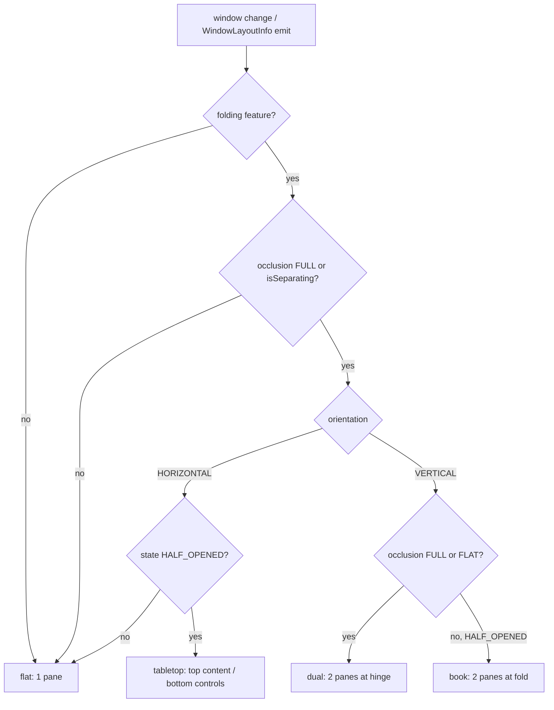
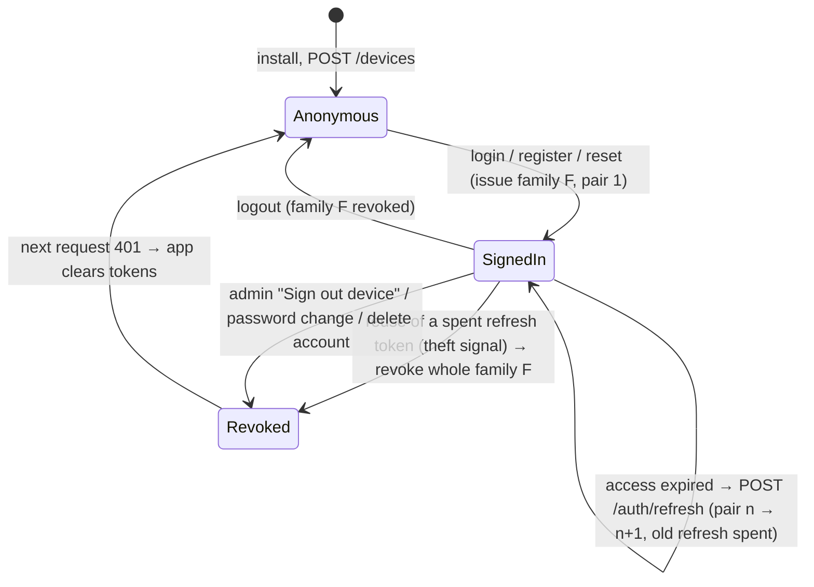
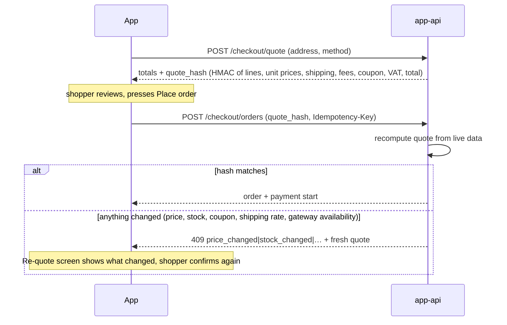
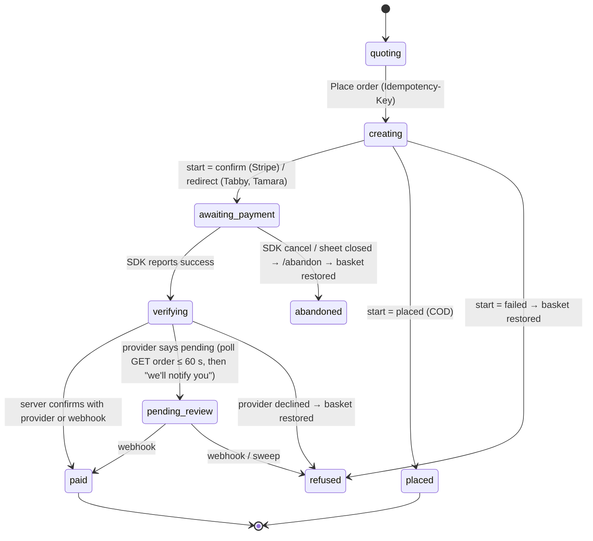
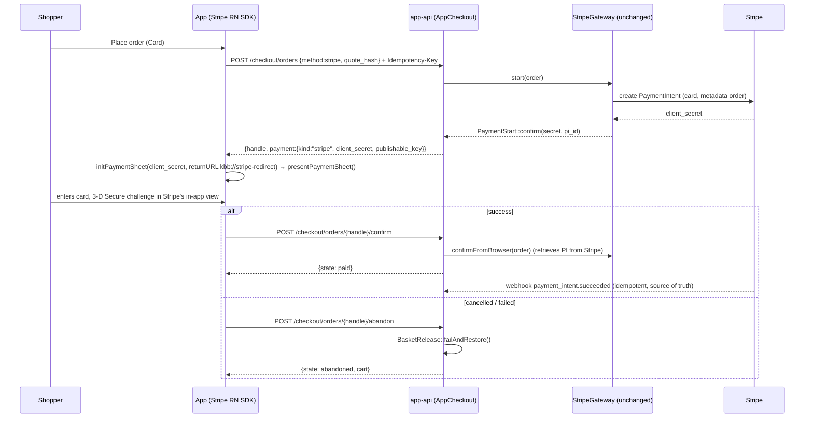
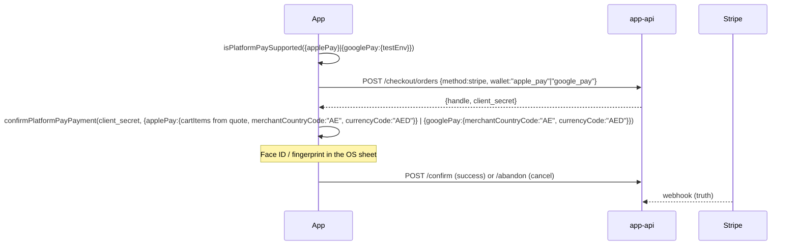
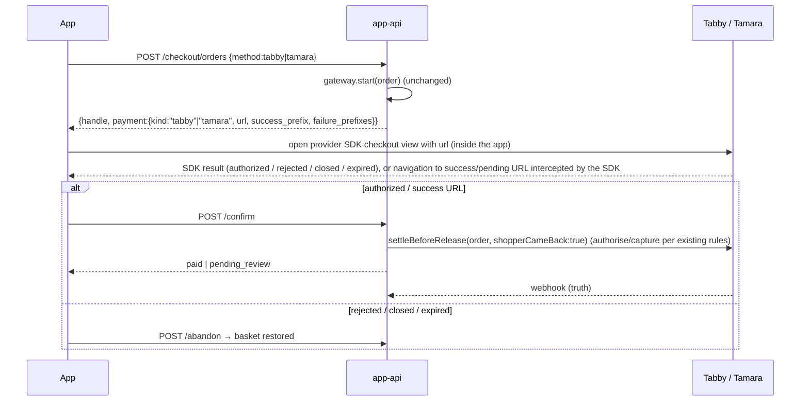

# K-Beauty Bliss mobile app — system design

**Status:** Phase 1 deliverable 1 of 2 (the other is the design previews, `docs/app-preview/`).
**Written:** 18 October 2026, Lane APD, against the repo at 2.60.544.
**Read first:** `docs/MOBILE-APP-PLAN.md` (what the owner agreed), then this file (how it is built).
**Binding on:** every lane that builds the app, the `/app-api` server side, or the admin screen for it.

The owner, 18 October 2026:

> "I want no bugs or styling issues upon any screen. and also i want the setup for folding mobiles like
> apple duos etc. ... proper planning and system design needed. don't let start in air. i need everything
> super perfect with advance technology."

This document is decision-complete: where a choice exists it is made here, with the reason. Anything that
depends on a third party's SDK behaviour on the day the code is written is marked **⟲ verify at build
time**; the builder checks it against the vendor's current docs and, if it moved, records the new fact in
§19 (Change log) before writing code against it.

Conventions: *dp* = Android density-independent pixels = iOS points. *Fils* = 1/100 AED, the unit every
price in the server already uses (`App\Support\Money`). File paths are this repository unless marked
`app:` (the new app repository, §16).

---

## Contents

1. Goals, non-goals and the quality bar as measurable gates
2. Stack
3. Adaptive layout and foldables
4. Server-driven UI for home and content screens
5. `/app-api/v1` — the API contract
6. Auth
7. Data, cache and offline
8. Payments in the app
9. Push
10. Deep links and universal links
11. Security
12. Analytics and privacy
13. Performance budgets and their enforcement
14. Quality system
15. Admin: App → Mobile app
16. Repository layout and design tokens
17. Phased delivery plan, risks
18. Open questions for the owner
19. Change log

---

## 1. Goals, non-goals and the quality bar

### 1.1 Goals

| # | Goal |
|---|---|
| G1 | Native iOS + Android app with **everything inside the app** (owner's rule, `MOBILE-APP-PLAN.md` §2): browse, search, bag, checkout with all five payment methods, account, orders, help. |
| G2 | English and Arabic with a true right-to-left mirror from day one, reading the **same** translations as the site (`TranslationStore`). |
| G3 | First-class layouts for phones, foldables (folded, unfolded, tabletop, dual-screen with hinge) and tablets, with no reload and no lost scroll when the device changes posture. |
| G4 | The website stays the single source of truth. An app order is an ordinary order in the admin: same stock, prices, emails, invoices, reports, Cart Tracking. |
| G5 | Home and content screens are **server-driven** from the same homepage sections the owner already edits, so content changes need no app release. |
| G6 | Zero change to the web checkout, the payment classes, the header/logo or the shop's speed (the four CLAUDE.md freezes). The app-api is **added beside** them and **composes** them. |

### 1.2 Non-goals (v1)

| Not in v1 | Why / when |
|---|---|
| Any WebView screen of our own | Owner's rule and Apple 4.2. The only embedded web surfaces are the ones a payment provider's own SDK draws (Stripe 3-D Secure, Tabby, Tamara), which is how those providers require it. |
| Instagram embeds (`igembeds` section), shoppable video player beyond a native video rail | Embeds are web widgets. Skipped by the app (§4.4). |
| Loyalty, routines builder, personalised home, app-only prices | v2 (`MOBILE-APP-PLAN.md` §6 phase 5). |
| Saved cards | Needs Stripe Customer objects; the web does not have them either. v2. |
| Passkey sign-in for customers | v2; v1 uses password + biometric unlock of a stored refresh token (§6). |
| Tablet-only features | Tablets get the expanded layouts, nothing extra. |
| Wear OS / watchOS / widgets / App Clips | Not asked. |

### 1.3 The quality bar, as gates

"No bug or styling issue on any screen" is enforced by these gates. A release that misses one does not
ship to 100 % (§14.6).

| Gate | Target | Measured by | Blocks |
|---|---|---|---|
| Crash-free sessions | ≥ **99.8 %** (and crash-free users ≥ 99.5 %) over the last 7 days of the rollout cohort | Sentry Release Health | Rollout past 10 % |
| ANR rate (Android) | < 0.2 % of sessions (Play "bad behaviour" threshold is 0.47 %) | Play Console vitals + Sentry ANR | Rollout past 10 % |
| Cold start to interactive home (from cache) | p75 ≤ **1.8 s** on reference mid devices (Pixel 7a, iPhone 12), ≤ 3.0 s on the low-end reference (Galaxy A15) | Sentry app-start + Maestro timing on device farm | Release |
| Screen transition | ≤ 300 ms tap to first frame of the next screen; no blank frame | Sentry navigation spans | Release |
| List scrolling | ≥ 58 fps median, < 2 % janky frames (> 16.7 ms) on 60 Hz; < 5 % frames over 8.3 ms on 120 Hz | Perf Monitor in Maestro perf flows, Android `gfxinfo`, Xcode Instruments on release builds | Release |
| JS errors | 0 unhandled JS errors in E2E; < 0.1 % sessions with any handled error in production | Sentry | Release |
| Visual regression | 0 unreviewed pixel diffs above 0.1 % per screen per size class per locale | Snapshot suite (§14.4) | Merge |
| Accessibility | Every interactive element has a role and label; 0 contrast failures (WCAG 2.2 AA: 4.5:1 text, 3:1 large text and UI); every screen usable at the **largest** Dynamic Type (iOS AX5) and Android font scale 200 % with nothing clipped or overlapping; full VoiceOver/TalkBack walk of the purchase path | Lint + RNTL a11y queries + manual audit script (§14.5) | Release |
| RTL parity | Every screen in Arabic is the mirror of English: no physical left/right style, no un-flipped directional icon, numbers and Latin brand names isolated correctly | Lint ban (§2.3), AR snapshots, AR Maestro flows | Merge |
| Hinge safety | No text, button or image focal area under a separating hinge or occlusion; tap targets ≥ 8 dp from it | Maestro on Surface Duo 2 and Fold emulators with hinge-overlap assertion (§3.9) | Merge |
| Payments | The whole server payment suite green **and** one real order per method from a release build before launch and after any payment-touching change (CLAUDE.md payment lock) | Pest + manual order log | Release |
| API contract | Every app-api response validates against `docs/app-api/openapi.yaml`; allowlist tests green | Pest (§14.7) | Merge (server) |

---

## 2. Stack

Versions: **the newest stable at the start of the build, never a beta or release candidate.** The table
gives the line that is current as of this writing (late 2026) and what the choice depends on. **⟲ verify at
build time** applies to every version number below; the *reasons* do not change with the number.

### 2.1 Core

| Layer | Choice | Version line | Why this, and not the alternative |
|---|---|---|---|
| Runtime | **React Native, New Architecture only** (Fabric renderer, TurboModules, bridgeless) | the RN version pinned by the chosen Expo SDK | One codebase, real native views. The legacy architecture is frozen upstream; FlashList v2 and Reanimated 4 already require the New Architecture. |
| JS engine | **Hermes** (bytecode precompiled at build) | bundled | Faster cold start, lower memory, the engine Sentry and the RN profiler target. JSC is not shipped by RN any more. |
| Framework | **Expo SDK** (managed workflow + config plugins + one local Expo module, §3.4) | newest stable SDK (55/56 line) | EAS Build/Submit/Update, config plugins instead of hand-edited native projects, Expo Modules API for our Kotlin/Swift module. |
| Routing | **Expo Router** with **typed routes** | ships with the SDK | File-based routes = deep-link map for free (§10); typed `href` catches a broken link at compile time; headless tabs (`expo-router/ui`) let one route tree render a bottom bar or a rail (§3.7) without remounting. |
| Language | **TypeScript `strict: true`** + `noUncheckedIndexedAccess`, `exactOptionalPropertyTypes` | TS 5.x | The API contract is generated into types (§5.13); unchecked index access is where "undefined is not an object" crashes come from. |
| Server state | **TanStack Query v5** + `@tanstack/query-async-storage-persister` over **MMKV** | v5 | Caching, dedupe, retries, stale-while-revalidate, offline persistence and optimistic mutations, all standard. |
| Fast storage | **react-native-mmkv** (v3+/Nitro) | current | Synchronous, ~30× faster than AsyncStorage; used for the query cache, bag, recent searches, UI prefs. **Never** for tokens (those go to SecureStore). |
| Local UI state | **Zustand v5** | v5 | Tiny, no provider, selector subscriptions avoid re-renders. Holds: bag (mirrored, §7.4), locale, size class overrides in dev, checkout draft. |
| Forms | **react-hook-form v7 + zod v4** (via `@hookform/resolvers`) | current | Uncontrolled inputs (no re-render per keystroke); zod schemas are shared with the API response validators. |
| Lists | **@shopify/flash-list v2** | v2 | Cell recycling, no `estimatedItemSize` guessing in v2, masonry and multi-column grids; the 60 fps gate depends on it. `FlatList` is banned by lint for lists that can exceed 20 items. |
| Images | **expo-image** | SDK | Memory + disk cache, `placeholder` blurhash/thumbhash, `recyclingKey` for FlashList cells, `srcset`-style `source` arrays (picks the smallest image ≥ the rendered size × density, §13.3), AVIF/WebP. |
| Animation | **react-native-reanimated v4** (+ `react-native-worklets`) and **react-native-gesture-handler v2** | v4 / v2 | UI-thread animations and gestures (gallery swipe, pinch zoom, bottom sheets) that do not drop frames when JS is busy. Reanimated 4 CSS-style transitions for simple state changes. |
| Safe areas | **react-native-safe-area-context** | current | Insets for notches, home indicator, Android 15+ edge-to-edge (enforced when targeting SDK 35+), and the Fold cover screen's cut-out. |
| Bottom sheets | **@gorhom/bottom-sheet v5** | v5 | Filters, sort, variant picker, address picker. Built on Reanimated + RNGH. **⟲ verify** its Reanimated 4 support at build time; fallback is a Reanimated-based sheet in `app:src/ui/Sheet`. |
| i18n | **i18next + react-i18next** with **expo-localization**; ICU plural rules via `Intl.PluralRules` (Hermes has Intl) | current | Arabic has six plural forms; i18next handles them. Strings come from the server (§2.3). |
| Fonts | **expo-font** config plugin (fonts embedded at build) | SDK | Outfit (Latin) + Cairo (Arabic), the site's pair. Embedded = no flash of fallback text on first launch. |
| Crash + perf | **@sentry/react-native** | current major | Crashes (JS + native), ANRs, app-start, navigation and HTTP spans, release health (the 99.8 % gate), source maps and Hermes debug IDs uploaded by EAS. |
| Build / ship | **EAS Build, EAS Submit, EAS Update** (+ EAS Workflows for CI on device) | current | Cloud builds (no Mac needed — the owner has none), signing keys held by EAS, over-the-air JS updates with channels, staged rollout and rollback (§14.6). |

### 2.2 Platform features

| Feature | Choice | Notes |
|---|---|---|
| Card payments, 3-D Secure, Apple Pay, Google Pay | **@stripe/stripe-react-native** — `PaymentSheet` for cards, `PlatformPayButton` + `confirmPlatformPayPayment` for wallets | Same PaymentIntent the web creates (`StripeGateway::start()` → `PaymentStart::confirm($clientSecret)`, card-only `payment_method_types`, which is what Apple Pay / Google Pay tokens are). §8. |
| Tabby | **Tabby React Native SDK** (Tabby's own in-app checkout view) | Tabby requires its SDK/in-app view, not an external browser. **⟲ verify** package name and API (at writing: `tabby-react-native-sdk`). |
| Tamara | **Tamara React Native SDK** | **⟲ verify** package name and API. Fallback if no maintained RN SDK exists: Tamara's documented in-app web view checkout using `react-native-webview` *inside the payment step only*, intercepting the success/failure/cancel URLs — the one permitted embedded web surface, because it is the provider's checkout, not our screen. |
| Push | **expo-notifications** for permission, tokens and handling; **native APNs/FCM device tokens** (`getDevicePushTokenAsync`), not Expo push tokens | The server sends to APNs/FCM directly (§9.3); no third-party relay sees message content. |
| Biometrics | **expo-local-authentication** | Face ID / Touch ID / fingerprint / face unlock; requires `NSFaceIDUsageDescription`. |
| Secrets on device | **expo-secure-store** (Keychain `WHEN_UNLOCKED_THIS_DEVICE_ONLY`; Android Keystore-backed encrypted prefs) | Refresh token, device id, guest order handles. `requireAuthentication: true` for the refresh token when the shopper turns biometric unlock on (§6.5). |
| Haptics | **expo-haptics** | Add to bag, success, error. Respect the OS "reduce haptics" settings. |
| Barcode search | **expo-camera** barcode scanning | Search by EAN on the box (`MOBILE-APP-PLAN.md` §5). Camera permission asked only when the scan button is tapped. |
| Share | React Native `Share` | Product share sheet with the universal link. |
| Store review prompt | **expo-store-review** | After the 2nd delivered order, at most once per 120 days. |
| Updates | **expo-updates** | Also used for the RTL reload (§2.3). |
| Network state | **@react-native-community/netinfo** + TanStack `onlineManager` | Offline banner, pause mutations. |
| Video (UGC rail) | **expo-video** | Native player, no WebView. |
| Screen orientation | **expo-screen-orientation** | Portrait lock on compact windows only (§3.8). |
| Foldables | **Our own Expo module `kbb-window-posture`** (Kotlin, Jetpack WindowManager) | §3.4. |
| WhatsApp hand-off | `Linking.openURL('whatsapp://send?phone=…')` with `https://wa.me/…` fallback | The one place the app hands off, on the Contact page only (18 Oct decision). |

### 2.3 Internationalisation and RTL — the mechanism

| Concern | Decision |
|---|---|
| Source of strings | The app's own UI strings live in the **site's** `InterfaceStrings` under an `app.` group with Arabic drafts (the site rule in HANDOVER §11.4), served by `GET /app-api/v1/strings?locale=` (ETag'd). A build-time snapshot ships in the binary so first launch offline still has words. Content (products, categories, pages, home sections) is translated server-side through `TranslationStore::forGroup()` / `HomeArabic::pick()` and arrives already in the asked locale. |
| Locale on requests | `?locale=en\|ar` query parameter on every content GET (not `Accept-Language`), so CDN/Varnish caching needs no `Vary` header. Customer endpoints take it too (emails, error text). |
| Arabic availability | `Locale::enabled('ar')` (`language_ar_enabled`) is published in `/config`. If the owner switches Arabic off, the language picker hides and an Arabic-set app falls back to English on next launch. |
| Direction switch | `I18nManager.allowRTL(true)` once; on a language change: persist choice → `I18nManager.forceRTL(isArabic)` → `Updates.reloadAsync()` behind a 250 ms branded cross-fade. **⟲ verify** that a JS reload is enough on Android for the SDK in use; if Android still needs an activity restart, the Expo module from §3.4 exposes `restartActivity()`. TanStack cache and navigation state are persisted first, so the shopper lands on the same screen. |
| Styles | **Logical properties only**: `marginStart/End`, `paddingStart/End`, `start/end`, `borderStartWidth`, `textAlign: 'auto'`. ESLint rule (`app:eslint/rules/no-physical-direction.js`) fails on `marginLeft\|marginRight\|paddingLeft\|paddingRight\|left\|right\|borderLeft*\|borderRight*\|textAlign:'left'\|'right'`. Exceptions need `// rtl-ok: <reason>` (e.g. a progress bar that must fill in reading direction uses `start`). |
| Icons | A `DirectionalIcon` wrapper flips (`scaleX: -1`) the named set: back/forward chevrons, arrows, "send", list bullets, the bag-with-arrow. Never flipped: logos, play/pause, check marks, clocks, the lotus, brand marks, numerals. |
| Mixed text | Latin brand names and SKU-like strings inside Arabic are wrapped with Unicode isolates (U+2068…U+2069) by a `bidi()` helper — the same class of bug HomeArabic fixed on the site (a full stop hung on the wrong side). |
| Numbers and prices | Follow the site: the same digits and currency label the site prints for that locale (`ArabicWording`, `Money`). One formatter, `formatPrice(fils, locale)`, generated from the server's `/config` currency block. |
| Fonts | `Outfit` for `en`, `Cairo` for `ar`, chosen by locale in the token layer (§16.3); line-height scale +8 % for Arabic. |

### 2.4 What not to use, and why

| Not used | Why |
|---|---|
| Any WebView screen (Capacitor, Ionic, `react-native-webview` for our pages) | Owner: "everything inside our app"; Apple **4.2 Minimum Functionality** rejects repackaged websites. Policies, blog posts, FAQ render natively from structured content (§5.6 `rich_text` blocks). The only embedded web content is a payment provider's own SDK surface (§8). |
| Redux / MobX / Context-as-store | TanStack Query owns server state; Zustand covers the little that is left. |
| AsyncStorage | Slow and unencrypted; MMKV for cache, SecureStore for secrets. |
| `FlatList` / `ScrollView` + `map` for long lists | Fails the 60 fps gate on 200-item grids. FlashList. |
| `react-native-fast-image` | Unmaintained for the New Architecture; expo-image replaces it. |
| Device sniffing (`Device.modelName === 'SM-F956B'`) for layout | Breaks on every new device. Window size classes and WindowManager features only (§3). |
| The Microsoft Surface Duo SDK / `react-native-dualscreen` | Deprecated by Microsoft; the Duo reports its hinge through Jetpack WindowManager like every foldable, which our module reads. |
| Firebase Analytics, AppsFlyer, Adjust, Meta/TikTok app SDKs (v1) | Third-party data collection → ATT prompt, heavier privacy label, more bytes. First-party analytics instead (§12). |
| Sanctum / Passport on the server | A new Composer dependency ("ask before adding any package", CLAUDE.md §4 "no new dependency"). A ~250-line token guard modelled on `OwnerAppAuth` is enough (§6). |
| Expo push service | A third party would see message text and device tokens; the server already signs ES256 JWTs for Web Push (`App\Services\OwnerApp\WebPush`), which is the APNs primitive (§9.3). |
| Moment.js, lodash (full) | Bundle size. `Intl.DateTimeFormat` / `date-fns` (tree-shaken) and native array methods. |
| TLS certificate pinning | §11.2. |

---

## 3. Adaptive layout and foldables

### 3.1 The model: window, not device

Every layout decision reads **the current window**, never the device model, recomputed on **every**
change (`useWindowDimensions` fires on rotation, fold/unfold, split-screen resize, Stage Manager resize and
Duo spanning).

| Size class | Window width (dp) | Typical windows |
|---|---|---|
| **compact** | < 600 | Every phone in portrait; Z Fold cover screen (≈ 344–373 dp); Z Flip; Pixel Fold outer; iPad Slide Over (320 pt); iPad ⅓ split |
| **medium** | 600 – 839 | Z Fold inner portrait (≈ 673–720 dp ⟲); one Surface Duo screen in landscape; iPad mini portrait (744 pt); iPad ½ split; large phones in landscape |
| **expanded** | ≥ 840 | Pixel Fold inner (≈ 840+ dp, landscape-native); Z Fold inner landscape; OnePlus Open inner; Surface Duo spanned; iPad portrait (11"/13") and landscape |

Height class is also derived (compact < 480 dp, medium 480–899, expanded ≥ 900) and used only for
landscape phones and tabletop half-panes (§3.5).

The dp figures for named devices are approximate and **⟲ verified on the emulator** at build time; the
code never contains them.

```ts
// app:src/layout/useLayout.ts — the ONLY place layout facts are computed
export type SizeClass = 'compact' | 'medium' | 'expanded';
export type Posture = 'flat' | 'tabletop' | 'book' | 'dual';      // §3.3
export interface Layout {
  width: number; height: number;                // window, dp
  sizeClass: SizeClass; heightClass: SizeClass;
  posture: Posture;
  hinge: null | { x: number; y: number; width: number; height: number; // dp, window coords
                  orientation: 'vertical' | 'horizontal'; separating: boolean; occludes: boolean };
  panes: Rect[];                                // 1 or 2 usable rectangles, hinge excluded
  insets: EdgeInsets;                           // safe area
}
export function useLayout(): Layout;            // memoised; re-renders only when a field changes
```

Rules for every component:

1. Read `useLayout()`; never call `Dimensions.get()` (stale after a fold) and never measure views to decide
   layout (`onLayout` is allowed for animations only, never to pick a layout — the same discipline the site
   follows with `calc()` instead of layout-measuring JS).
2. Breakpoint values come from `tokens.breakpoints` (§16.3), never literals.
3. A screen's layout is a pure function of `Layout` + data, so it can be snapshot-tested per class (§14.4).

### 3.2 Platform reality per device family

| Device | What the OS reports | Our handling |
|---|---|---|
| Galaxy Z Fold 5/6/7 | Cover: tall narrow compact window. Inner: near-square medium (portrait) / expanded (landscape). `FoldingFeature` vertical, `FLAT` when open; `HALF_OPENED` + `isSeparating=true` in book posture; occlusion `NONE` | Cover = compact layouts (tested at 344 dp, the narrowest). Inner = medium/expanded. Book posture (half-open vertical) = two panes split at the fold. |
| Galaxy Z Flip 5/6/7 | Compact phone. Half-open: `FoldingFeature` **horizontal**, `HALF_OPENED`, separating | **Tabletop** (§3.5). |
| Pixel Fold / Pixel 9–10 Pro Fold | Outer compact; inner expanded (Pixel Fold) or medium/expanded (Pro Fold). Vertical fold | As Z Fold. |
| OnePlus Open, Honor Magic V, Vivo X Fold | Same WindowManager contract | Same code path; no special cases. |
| Microsoft Surface Duo / Duo 2 | Two screens (Duo 1: 1350×1800 px each, 34 px hinge; Duo 2: 1344×1892 px each, 66 px hinge ⟲). App on one screen = one compact/medium window. **Spanned** = one window across both with a `FoldingFeature` whose bounds are the hinge, `occlusionType = FULL`, `isSeparating = true`, always | **Dual** posture (§3.6): two panes exactly the two screens; nothing drawn under the hinge. Microsoft ended Duo OS support, so it is a correctness target, not a volume target. |
| iPad: Split View, Slide Over, Stage Manager, external display | Window resizes arbitrarily; no hinge | Size classes only. `UIRequiresFullScreen = false`; all four orientations on iPad. |
| iPhone | Compact; landscape is compact width on most models, medium on Pro Max landscape | Portrait-locked on iPhone (§3.8). |
| Android 16+ large screens (sw ≥ 600 dp) | The OS **ignores** orientation locks and resizability restrictions for apps targeting API 36 ⟲ | We never rely on a lock there: every screen has medium/expanded layouts in both orientations. |

### 3.3 Posture and hinge — what the module reports

Jetpack WindowManager `WindowInfoTracker.windowLayoutInfo(activity)` emits `WindowLayoutInfo.displayFeatures`;
we read the `FoldingFeature`:

| WindowManager field | Values | Mapped to |
|---|---|---|
| `state` | `FLAT`, `HALF_OPENED` | flat vs folded |
| `orientation` | `VERTICAL`, `HORIZONTAL` | book/dual vs tabletop |
| `isSeparating` | bool | whether content must split around it |
| `occlusionType` | `NONE`, `FULL` | whether the hinge hides pixels (Duo) |
| `bounds` | `Rect` in window px | hinge rect → dp via `PixelRatio` |

Derived `posture`:

| Condition | posture | Panes |
|---|---|---|
| no folding feature, or `FLAT` and not separating | `flat` | one pane = window |
| `HALF_OPENED` + `HORIZONTAL` | `tabletop` | top pane above hinge, bottom pane below |
| `HALF_OPENED` + `VERTICAL` | `book` | start pane, end pane |
| `isSeparating` + `occlusionType FULL` (Duo spanned) | `dual` | the two screens, hinge excluded |
| `FLAT` + `isSeparating` + `VERTICAL` (Duo-like but no occlusion) | `dual` | two panes split at the fold |



### 3.4 The native module: `kbb-window-posture` (Expo module, Kotlin)

No maintained React Native library exposes Jetpack WindowManager for the New Architecture with occlusion
and bounds (**⟲ verify** at build time; if one appears that does, evaluate it against this API and keep
ours if it falls short). We write a small local Expo module — about 150 lines of Kotlin, no-op on iOS.

`app:modules/kbb-window-posture/`

| File | Content |
|---|---|
| `expo-module.config.json` | platforms `android`, `ios` |
| `android/build.gradle` | `implementation "androidx.window:window:<current 1.x>"` ⟲ |
| `android/src/main/java/ae/kbb/windowposture/KbbWindowPostureModule.kt` | Expo `Module` definition |
| `ios/KbbWindowPostureModule.swift` | returns `null` feature, emits nothing (iPad needs only size classes) |
| `index.ts` | JS API below |
| `plugin/withWindowPosture.ts` | config plugin: `android:configChanges`, `resizeableActivity` (§3.8) |

Kotlin outline:

```kotlin
class KbbWindowPostureModule : Module() {
  private var job: Job? = null
  override fun definition() = ModuleDefinition {
    Name("KbbWindowPosture")
    Events("onPostureChange")
    Function("current") { lastPayload }                      // sync read for first render
    OnActivityEntersForeground { start() }
    OnActivityEntersBackground { job?.cancel() }
    OnDestroy { job?.cancel() }
  }
  private fun start() {
    val activity = appContext.currentActivity as? ComponentActivity ?: return
    job?.cancel()
    job = activity.lifecycleScope.launch {
      activity.repeatOnLifecycle(Lifecycle.State.STARTED) {
        WindowInfoTracker.getOrCreate(activity).windowLayoutInfo(activity).collect { info ->
          val f = info.displayFeatures.filterIsInstance<FoldingFeature>().firstOrNull()
          lastPayload = toPayload(f, activity)                // bounds px -> dp with density
          sendEvent("onPostureChange", lastPayload)
        }
      }
    }
  }
}
```

JS API:

```ts
// app:modules/kbb-window-posture/index.ts
export interface FoldPayload {
  feature: null | {
    state: 'flat' | 'half_opened';
    orientation: 'vertical' | 'horizontal';
    separating: boolean;
    occlusion: 'none' | 'full';
    bounds: { x: number; y: number; width: number; height: number }; // dp, window coordinates
  };
}
export function currentPosture(): FoldPayload;                       // sync, for first frame
export function addPostureListener(cb: (p: FoldPayload) => void): Subscription;
```

`useLayout()` combines `useWindowDimensions()`, `useSafeAreaInsets()` and this listener. Updates are
coalesced to one per animation frame so a fold that fires both a resize and a posture event renders once.

Test hook: in dev builds, a hidden "Layout lab" screen (§14.4) overrides `Layout` to any class/posture, so
every combination can be screenshot on any device.

### 3.5 Tabletop (Z Flip half-open, Fold half-open landscape)

| Screen | Top pane (content) | Bottom pane (controls) |
|---|---|---|
| Product | Gallery (swipe, zoom) / video | Price, variant chips, Add to bag, instalment line |
| UGC / video rail | Video | Caption, product chip, next/prev |
| Checkout payment | Order summary | Payment method list + Pay button |
| All other screens | — | fall back to the flat compact layout with the hinge band left empty (a 1-pane layout that reserves the hinge rect as a spacer) |

Rule: tabletop layouts are entered only when the bottom pane is ≥ 240 dp tall; otherwise flat.

### 3.6 Dual-screen and book posture (Duo spanned, Fold half-open portrait)

The window splits into `panes[0]` (start) and `panes[1]` (end); the hinge rect is a non-drawable gap.
In RTL, `panes[0]` is the **right** screen (start side), so list → detail reads in reading direction.

| Screen | Start pane | End pane |
|---|---|---|
| Shop / category / brand / search results | Product grid (2 columns) | Product detail of the selected tile (first tile pre-selected); tapping a tile updates the end pane, no navigation push |
| Product | Gallery | Details, tabs, reviews, Add to bag |
| Bag | Line items | Summary, coupon, free-delivery bar, Checkout button |
| Checkout | Steps (address → delivery → payment) | Live order summary |
| Account → Orders | Order list | Order detail |
| Home | Sections in a single column, flowing down the start pane | …then continuing in the end pane; no section is ever cut across the hinge |
| Blog | Article list | Article |

**Continuity across the split:** the pane pair is the *same* route with a `selected` param (e.g.
`/shop?selected=slug`), not two navigators. Folding back to one pane shows the start pane; if the shopper
had opened detail on the end pane, the router pushes the detail screen so nothing they were reading
disappears (`useSpanTransition()`).

### 3.7 Navigation per class

| Class | Primary navigation | Notes |
|---|---|---|
| compact | Bottom tab bar: Home · Shop · Search · Bag (count) · Account | 56 dp + bottom inset. Hidden on product (sticky Add to bag replaces it) and in checkout. |
| medium | **Navigation rail** on the start edge, 80 dp, same five destinations, labels under icons | Content max width 720 dp, centred in the remaining space. |
| expanded | Navigation rail (labels beside icons when width ≥ 1200 dp) | Content uses multi-pane layouts (§3.9). |
| dual / book | Rail on the start pane's start edge; never on the hinge | |

Implementation: one Expo Router `(tabs)` group built with the headless `expo-router/ui` `Tabs`/`TabList`/
`TabSlot` (**⟲ verify** API name for the SDK in use), rendering `<BottomBar/>` or `<Rail/>` from
`useLayout().sizeClass`. Because it is the same navigator, folding a phone open swaps the bar for a rail
**without remounting a single screen** — scroll position and in-progress input survive.

### 3.8 Continuity: fold/unfold without reload

| Mechanism | Setting |
|---|---|
| Android activity is **not recreated** on fold, resize or posture change | `android:configChanges="keyboard\|keyboardHidden\|orientation\|screenSize\|smallestScreenSize\|screenLayout\|uiMode\|density"` on `MainActivity` (config plugin). Expo's template has historically omitted `smallestScreenSize` and `density`; without them unfolding a Fold **recreates the activity and reloads the JS** — the exact "state lost on unfold" bug. **⟲ verify** on Fold and Duo emulators that `density` handling causes no font-scale glitch; if it does, drop `density` and rely on the persistence below. |
| Resizable | `android:resizeableActivity="true"`; no `maxAspectRatio` |
| Orientation | iPhone: portrait in `Info.plist`. iPad: all. Android: manifest unspecified; at runtime, `expo-screen-orientation` locks portrait **only while** the smallest window dimension < 600 dp (phones, Fold cover, Flip), and unlocks otherwise. |
| Belt and braces | Navigation state persisted to MMKV on every change; TanStack cache persisted; scroll offsets of FlashLists held in a Zustand map keyed by route + list id and restored with `initialScrollIndex`. If the OS ever does kill and restore, the shopper lands where they were. |
| Layout swap without remount | Layout components switch **children** (one pane vs two) but keep the same keyed list instance where the list survives (the grid in start pane is the same FlashList element, keyed `grid:<route>`). |

### 3.9 Per-screen layout rules

Grid columns are computed, not listed per device: `columns = clamp(floor((paneWidth − 2·gutter + gap) / (minTile + gap)), min, max)`.
Tokens: `gutter` compact 16 / medium 24 / expanded 32 dp; `gap` 12 dp; `minTile` 160 dp.

| Screen | compact | medium | expanded | dual / book | tabletop |
|---|---|---|---|---|---|
| **Home** | Single column of sections; rails scroll horizontally, 2.3 cards visible | Single column, max width 720 dp; rails show 3.3 cards | Two-column section flow where a section declares `span: half` (brand cards, blog cards, feature); rails 4.5 cards; hero max height 420 dp | Sections flow start pane → end pane | flat compact |
| **Shop / category / brand** | 2 columns; filter + sort as a bottom sheet; sticky filter bar | 3 columns; filter sheet | 4–5 columns + **persistent filter side panel** (280 dp, start side) | grid start / detail end (§3.6) | flat |
| **Product** | Gallery full width (aspect 1:1), details below, sticky Add-to-bag bar | Gallery 55 % / details 45 % side by side when width ≥ 700 dp, else stacked | Two-pane: gallery (sticky, start) / details (scrolls, end), max width 1200 dp | Gallery start pane / details end pane | Gallery top / buy controls bottom (§3.5) |
| **Search** | Field on top; recent/popular → instant results list | Results as 3-column grid | Results grid + filter side panel | results start / detail end | flat |
| **Bag** | List, then summary; sticky Checkout bar | List + summary side by side ≥ 700 dp | List (start, 60 %) / summary card (end, sticky) | list start / summary end | flat |
| **Checkout** | Single column, step by step | Single column, **max width 600 dp**, centred | Single column max 600 dp **plus** a sticky order summary on the end side when width ≥ 1000 dp | steps start / summary end | summary top / payment bottom on the payment step |
| **Account** | List of rows | Rows, max width 720 dp | Master (menu) / detail (selected section) | menu start / detail end | flat |
| **Orders** | List → detail | List, max 720 dp | List / detail two-pane | list start / detail end | flat |
| **Blog / pages** | Article, 16 dp margins, max line length governed by width | Max text column 640 dp | Max text column 680 dp, related posts in side column | list start / article end | flat |
| **Sheets & dialogs** | Bottom sheets | Bottom sheets, max width 600 dp, centred | Centred dialogs (max 560 dp) instead of sheets | sheet on the pane that opened it, never across the hinge | sheet in bottom pane |

Global rules:
- Text measure: body text columns never exceed 680 dp (≈ 75 characters).
- Minimum touch target 48 × 48 dp (Android) / 44 × 44 pt (iOS): we use 48 everywhere.
- **Hinge rule:** nothing interactive within 8 dp of a separating hinge; no image focal crop, no text line
  under an occluding hinge. Enforced by a test helper that walks the accessibility tree in Maestro on the
  Duo and Fold book posture and fails if any element's frame intersects `hinge` ± 8 dp.
- Edge-to-edge on Android 15+: content draws behind system bars; every screen consumes `insets`.

### 3.10 Device test matrix

| Device (emulator / simulator unless noted) | Classes / postures exercised | What is checked |
|---|---|---|
| iPhone SE (3rd gen), 375 pt | compact, smallest iOS | Nothing clipped at AX5 Dynamic Type; bottom bar + sticky buy bar fit |
| iPhone 16/17 | compact | Reference phone for snapshots and timing |
| iPhone 16/17 Pro Max | compact (landscape would be medium; we lock portrait) | Large-phone spacing |
| iPad mini (744 pt) | medium portrait, expanded landscape | Rail, 3-col grid, sheets centred |
| iPad Pro 13" | expanded; Split View ½ and ⅓; Slide Over; Stage Manager resize | Live resize with no remount; state kept |
| Pixel 8a / 9 | compact | Android reference phone; edge-to-edge |
| Galaxy A15 (physical, device farm) | compact, low-end | Cold start and scroll budgets |
| **Pixel Fold** (Android Studio foldable AVD) | outer compact, inner expanded, half-open book | fold/unfold continuity, book two-pane |
| **Galaxy Z Fold 6/7** (Samsung emulator skin / Remote Test Lab ⟲) | cover 344–373 dp compact; inner medium portrait / expanded landscape | narrowest compact layout; cover → inner continuity (App Continuity on) |
| **Galaxy Z Flip 6/7** (Samsung skin / RTL ⟲) | compact; tabletop | Product and checkout tabletop layouts |
| **Surface Duo 2** (Microsoft emulator image ⟲; Android 12L) | single screen compact; spanned dual (hinge occluding) | Two panes on two screens; hinge-overlap assertion; RTL dual order |
| Android "Resizable (Experimental)" AVD | all three classes switched live | the size-class transitions in one session |
| Pixel Tablet | expanded | Rail with labels, 5-column grid |

Each device runs: the Maestro smoke suite (every screen, EN and AR), the snapshot set for its classes, and —
on the four foldable rows — the **continuity flow**: open a category, scroll to row 20, open filters,
fold/unfold/span, assert same row visible, filter sheet still open, no network refetch of the list.

---

## 4. Server-driven UI (home and content screens)

### 4.1 Principle

The home screen is **data, not code**: `GET /app-api/v1/home?locale=ar` returns an ordered, typed list of
sections built from the **same** `App\Services\HomepageSections` registry and settings the owner edits in
Appearance → Homepage (order, on/off, per-section content from `HomeSections::data()`, Arabic from
`HomeArabic`, concerns from `ShopByConcern::section()`, bundles from `HomeBundles`, rails from
`HomeSections::rail()`). The app renders each `type` with a native component.

**This answers the owner's question:** a change to *content* (a new banner, re-ordered sections, a section
switched off, new products in a rail, new Arabic wording) appears in the app on next open with **no app
update**. A new section **type** (a layout that has never existed) needs one OTA update (EAS Update, no
store review) adding its renderer; older apps skip it until they update (§4.3).

### 4.2 Response shape

```jsonc
// GET /app-api/v1/home?locale=en           (ETag, Cache-Control: public, max-age=60, stale-while-revalidate=600)
{
  "schema": 1,                                  // section schema version (§4.3)
  "generation": "h_9f2c1a",                     // changes whenever homepage settings or rails change
  "locale": "en", "dir": "ltr",
  "sections": [
    { "id": "cards_banner", "type": "banner_carousel", "v": 1, "span": "full",
      "data": { "autoplay_ms": 5000, "slides": [
        { "image": { "src": "…/img-cache/1280/uploads/b1.jpg", "w": 1280, "h": 640,
                     "variants": [{ "w": 800, "src": "…" }, { "w": 1280, "src": "…" }, { "w": 1920, "src": "…" }],
                     "placeholder": "LKO2?U%2Tw=w]~RBVZRi};RPxuwH", "alt": "Autumn sale" },
          "link": { "url": "https://kbeautybliss.com/super-sale/", "label": "Shop the sale" } } ] } },
    { "id": "concerns", "type": "concern_chips", "v": 1, "span": "full", "data": { "title": "Shop by skin concern", "items": [ … ] } },
    { "id": "bestselling", "type": "product_rail", "v": 1, "span": "full",
      "data": { "title": "Best sellers", "see_all": { "url": "https://kbeautybliss.com/best-sellers/" },
                "products": [ /* ProductCard, §5.5 */ ] } }
  ],
  "flags": { "show_instalments": true },
  "min_app": { "ios": "1.0.0", "android": "1.0.0" }
}
```

Rules:
- Every URL inside `data` is a **shop URL**, resolved in the app through the single URL → screen router
  (§10.3). One mapping for push, deep links, banners and home links; no screen ids in content.
- Images carry their img-cache variants (§13.3) and a placeholder hash (§13.3).
- Text is plain or `rich_text` blocks (§5.6) — **never HTML** (the app has no HTML renderer by design).
- Visibility: a section is included when its **mobile** switch is on (the app is a mobile surface) unless
  the owner sets an app override in App → Mobile app → Home (§15). Sections the app cannot draw natively
  are omitted server-side (`igembeds`).

### 4.3 Versioning and unknown types

| Mechanism | Rule |
|---|---|
| `schema` (envelope) | Integer. Bumped only when the envelope changes incompatibly. The app sends `X-App-Schema: 1`; the server answers in that schema or 426 `upgrade_required`. |
| `type` + `v` (per section) | The app declares what it can draw: `X-App-Sections: banner_carousel@1,product_rail@1,…` (a compact header from a generated constant). The server omits sections whose `type@v` the app does not list, and **also** the app skips anything unknown (defence in both places). |
| Additive fields | Allowed within a `v`; renderers ignore unknown fields (zod `.passthrough()` off, `.strip()` on). |
| New type | Server ships it (one package); app ships the renderer by OTA; until then old apps never receive it. |
| Feature flags | `/config.flags` (booleans + string enums only), set in App → Mobile app → Feature flags. Evaluated client-side; no per-user targeting in v1. |
| Minimum version | `/config.min_app.{ios,android}` (hard: blocking "Please update" screen with store button) and `recommended_app` (soft: dismissible banner once per version). Transactional endpoints also enforce `min_app` server-side (426). |

### 4.4 Section type map

From `HomepageSections::REGISTRY` keys (the site's own) to app section types. The builder confirms each
mapping against the section's Blade partial and data source before writing its renderer.

| Registry key | App type | Source on the server | v1 |
|---|---|---|---|
| `topstrip` | `notice_strip` | Homepage content top strip | yes |
| `cards_banner` | `banner_carousel` | `Banners` / card banners | yes |
| `countries` | `country_strip` | Homepage strips (`HomeStrips`) | yes |
| `hero` | `hero` | `HomepageContent` slides + `HomeArabic::slide()` | yes |
| `delivery`, `trust` | `trust_strip` | `HomeStrips` | yes |
| `ticker` | `ticker` | Homepage content | yes |
| `categories` | `category_chips` | category tree | yes |
| `bundles` | `bundle_rail` | `HomeBundles` | yes |
| `bestselling`, `recommended`, `trending` | `product_rail` | `HomeSections::rail()` | yes |
| `bestsellers`, `under54` | `product_grid` | `HomeSections::rail()` | yes |
| `flash` | `flash_sale` (countdown from server `ends_at`) | flash settings | yes |
| `brands` | `brand_cards` | `HomeSections::brands()` / `brandPhoto()` | yes |
| `concerns` | `concern_chips` | `HomeConcerns` | yes |
| `sbc` | `concern_tabs` | `ShopByConcern::data()` / `section()` | yes |
| `spotted` | `ugc_grid` | `SpottedInstagram` (images only, no embed) | yes |
| `videos` | `video_rail` | `UgcRail` (shoppable video module; omitted when the module is off) | yes |
| `blog` | `blog_cards` | `HomeSections::blog()` | yes |
| `feature` | `feature_split` | `HomeSections::feature()` | yes |
| `about` | `rich_text` | `HomeSections::about()` / `HomeArabic::about()` | yes |
| `reviews` | `review_cards` | reviews module (when the owner picks a design and switches it on) | yes |
| `newsletter` | `newsletter_signup` | `NewsletterSettings` | yes |
| `quiz` | `quiz_cta` (links to native quiz screen) | quiz settings | v1.1 |
| `routine` | `routine_cta` | `BuildMyRoutine` (off on the site) | v2 |
| `igembeds` | — omitted | web embeds | never |

### 4.5 Other server-driven screens

| Endpoint | Screen | Structure |
|---|---|---|
| `/pages/{slug}` | Policies, Terms, Privacy, Delivery, Returns, FAQ, About, Contact | `rich_text` blocks; FAQ as `accordion` |
| `/posts`, `/posts/{slug}` | Blog | cards; article as `rich_text` blocks with images |
| `/menu` | Shop tab (category tree, brands A–Z, concerns, collections) | tree from `NavigationService` / mega menu data |
| `/collections/{key}` | New in, Best sellers, Super sale, Under 54 | listing envelope (§5.5) |

### 4.6 Server construction and cost

`App\Services\AppApi\HomePayload` builds the payload **from the services above, not from rendered HTML**,
caches it per `(locale, schema, generation)` for 10 minutes in the cache store, and keys `generation` on
the existing invalidation points (`HomeSections::flush()`, `ShopByConcern::GENERATION`, settings writes).
Cost: one settings-map read (inside `SettingsRequestMemo`), and on a cache miss the same queries the home
page itself spends; a test asserts the query count is the same with 3 and 40 products per rail (the
`BrandPageOwnerAsksTest` pattern, CLAUDE.md §4).

---

## 5. `/app-api/v1` — the API contract

### 5.1 Where it lives on the server (this repo)

| Piece | Path |
|---|---|
| Routes | `routes/app-api.php`, loaded in the **`api` middleware group** (stateless, no CSRF, `BlockGate` prepended — §11.4) with prefix `app-api/v1`. Wired by the integrator (CLAUDE.md: lanes do not edit `routes/web.php`); ships with a `clear_caches_*` migration. |
| Controllers | `app/Http/Controllers/AppApi/*Controller.php` — thin |
| Services | `app/Services/AppApi/*` — presenters (allowlists), `AppCheckout`, `HomePayload`, `AppTokens`, `AppPushTransport` |
| Guard | `app/Services/AppApi/AppTokens.php` + `Auth::viaRequest('app', …)` registered in a provider |
| Module | `mobile_app` in `ModuleRegistry`, **off** until launch; every app-api route answers 404 while off (fail closed, like `shoppable_video`) |
| Contract | `docs/app-api/openapi.yaml` (OpenAPI 3.1) — the source the app generates types from |
| Tests | `tests/Feature/AppApi/*Test.php` (§14.7) |

### 5.2 Conventions

| Topic | Rule |
|---|---|
| Base URL | `https://<shop host>/app-api/v1` — the canonical host only (`CanonicalHost` would 301 any other; the app never follows a redirect on a write). Host fixed per EAS channel (`production`, `staging`). |
| Format | JSON, UTF-8, `snake_case` keys, money as **integer fils** + currency code, timestamps ISO 8601 UTC with `Z`, ids as strings. |
| Request headers | `X-App-Version: 1.4.2`, `X-App-Build: 142`, `X-Platform: ios\|android`, `X-App-Schema: 1`, `X-Device: <device id>` (opaque UUID, §6.2), `Authorization: Bearer <access>` when signed in, `X-Cart: <cart token>` for guest bags, `Idempotency-Key` on creates (§5.9). |
| Locale | `?locale=en\|ar` (§2.3) |
| Pagination | **Cursor**: `?limit=24&cursor=<opaque>`; response `{ "items": [...], "next_cursor": "…" \| null }`. Cursor = base64url of the last row's sort tuple + an HMAC so it cannot be forged into an arbitrary offset. `limit` max 48. |
| Errors | RFC 9457 (successor of 7807) `application/problem+json` — §5.10. |
| Caching | §5.11. |
| Allowlists | Every response built by a presenter with an explicit key list (`Product::toApi()` and `SettingController::PUBLIC_KEYS` are the house pattern). **Never** `$model->toArray()`. Forbidden fields pinned by test: `wc_id`, `sku`*, `total_sales`, `author_email`, `ip`, `admin_path`, `indexnow_key`, any gateway key, `cookie_hash`, token hashes, internal notes. (*`sku`/barcode is matched server-side for barcode search but never returned.) |

### 5.3 Endpoint list

Auth column: **P** public (no token), **D** device header required, **G** guest or customer (cart token or bearer), **C** customer bearer required. Rate limits are per device id **and** per IP (/64 for IPv6), whichever trips first.

#### Config and content (read)

| Method | Path | Auth | Purpose | Limit |
|---|---|---|---|---|
| GET | `/config` | P | min/recommended app versions, flags, locales enabled, currency + format, VAT mode, free-delivery threshold, COD fee, gateway publishable info (Stripe publishable key, Apple merchant id, Google Pay env), support contact, WhatsApp number, legal page slugs, image width sets, strings generation | 60/min |
| GET | `/strings?locale=` | P | app UI strings (ETag) | 30/min |
| GET | `/home?locale=` | P | §4 | 60/min |
| GET | `/menu?locale=` | P | category tree, brands, concerns, collections | 60/min |
| GET | `/products?locale=&category=&brand=&concern=&collection=&q=&min=&max=&in_stock=&sort=&cursor=&limit=` | P | listing (§5.5) | 120/min |
| GET | `/products/{slug}?locale=` | P | product detail | 120/min |
| GET | `/products/{slug}/reviews?cursor=` | P | approved reviews only | 60/min |
| GET | `/products/{slug}/related` | P | bought together, also like, related | 60/min |
| GET | `/products/by-barcode/{ean}` | P | → `{ slug }` or 404 | 20/min |
| GET | `/search/suggest?q=&locale=` | P | instant results (same engine as `Store\SearchController::suggest`) | 120/min |
| GET | `/search/starter?locale=` | P | popular terms | 30/min |
| GET | `/brands`, `/brands/{slug}` | P | brand list / brand page header + listing link | 60/min |
| GET | `/categories/{path}` | P | category header + children | 60/min |
| GET | `/posts?cursor=`, `/posts/{slug}` | P | blog | 60/min |
| GET | `/pages/{slug}` | P | policy/content pages | 60/min |
| GET | `/countries` | P | ship-to countries + emirates/areas | 30/min |
| POST | `/resolve-url` | P | `{ url }` → `{ screen, params }` for any shop URL the app's local table does not know (§10.3) | 60/min |

#### Device, auth and account

| Method | Path | Auth | Purpose | Limit |
|---|---|---|---|---|
| POST | `/devices` | P | register install → `{ device_id }` (§6.2) | 10/hour/IP |
| POST | `/auth/register` | D | create customer → tokens | 5/hour |
| POST | `/auth/login` | D | email + password → tokens (+ merges guest bag, §6.7) | 10/15min/device; lockout ladder as `OwnerAppAuth` |
| POST | `/auth/refresh` | D | rotate refresh → new pair | 30/hour |
| POST | `/auth/logout` | C | revoke this device's family | 30/hour |
| POST | `/auth/forgot` | D | send reset email (link opens app, §10) — same answer whether the email exists or not | 5/hour |
| POST | `/auth/reset` | D | `{ id, token, password }` → tokens | 10/hour |
| POST | `/auth/verify-email/resend` | C | | 3/hour |
| GET | `/me` | C | profile (allowlisted) | 60/min |
| PATCH | `/me` | C | name, phone, locale, marketing consent | 20/hour |
| POST | `/me/password` | C | change password (revokes other devices) | 5/hour |
| GET | `/me/devices` / DELETE `/me/devices/{id}` | C | see and sign out own devices | 20/hour |
| POST | `/me/delete` | C | delete account (§5.8) — requires password re-entry | 3/day |
| GET/POST | `/me/addresses` | C | list / create | 30/hour (writes) |
| PATCH/DELETE | `/me/addresses/{id}` | C | update / delete (ownership checked; 404 if not yours) | 30/hour |
| POST | `/me/addresses/{id}/default` | C | | 30/hour |

#### Wishlist, reviews, contact

| Method | Path | Auth | Purpose | Limit |
|---|---|---|---|---|
| GET | `/wishlist` | C | ids + cards | 60/min |
| PUT / DELETE | `/wishlist/{product_id}` | C | idempotent add/remove (the site's wishlist is a cookie, `WishlistController::COOKIE`; the app needs a server table `customer_wishlist` — new; also feeds `PushAutomations::wished()` price-drop alerts) | 60/min |
| POST | `/products/{slug}/reviews` | C | submit review (+ up to 4 photos) — **signed-in only** in the app, replacing the web's captcha; same per-customer cap and `reviews_enabled` switch as `Api\ProductController::submitReview` | 5/hour |
| POST | `/reviews/{id}/helpful` | D | same per-IP cap as the web | 30/hour |
| POST | `/contact` | D | in-app contact form → the existing Contact inquiries inbox (`ContactInquiryController` logic, composed) | 5/hour |
| POST | `/newsletter` | D | subscribe | 5/hour |
| POST | `/stock-alerts` | D | back-in-stock request (`StockAlerts`) — push if device registered, else email | 20/hour |

#### Bag

| Method | Path | Auth | Purpose | Limit |
|---|---|---|---|---|
| POST | `/cart` | D | create guest cart → `{ cart_token }` | 10/hour |
| GET | `/cart` | G | lines, totals, free-delivery progress, coupon, unavailable lines, `quote_hash` | 120/min |
| POST | `/cart/items` | G | `{ product_id, variant_id?, qty }` | 60/min |
| PATCH / DELETE | `/cart/items/{id}` | G | qty / remove | 60/min |
| PUT | `/cart/sync` | G | replace lines from an offline-edited local bag (§7.4) → authoritative cart | 20/min |
| POST / DELETE | `/cart/coupon` | G | apply / remove (`CouponService`) | 20/min |
| POST | `/cart/merge` | C | merge guest `X-Cart` into the customer's cart (`CartService::mergeGuestCart`) | 10/hour |

#### Checkout and payment

| Method | Path | Auth | Purpose | Limit |
|---|---|---|---|---|
| POST | `/checkout/quote` | G | `{ address, ship_method?, method? }` → shipping rates, VAT, COD fee, gateway list for the country (`GatewayRegistry::checkoutList()` + `GatewayCountries`), totals, `quote_hash` | 60/min |
| POST | `/checkout/orders` | G | **create order + start payment**; requires `Idempotency-Key` and `quote_hash` (§8) | 10/10min |
| GET | `/checkout/orders/{handle}` | G | order + payment state (poll after SDKs return) | 60/min |
| POST | `/checkout/orders/{handle}/confirm` | G | client says the provider finished (Stripe → `confirmFromBrowser`-equivalent; Tabby/Tamara → settle check) — server verifies with the provider, never trusts the claim | 20/10min |
| POST | `/checkout/orders/{handle}/abandon` | G | the shopper closed the sheet / SDK cancelled → `BasketRelease::failAndRestore()` | 20/10min |

#### Orders, push, events

| Method | Path | Auth | Purpose | Limit |
|---|---|---|---|---|
| GET | `/orders?cursor=` | C | own orders | 60/min |
| GET | `/orders/{handle}` | G* | order detail + tracking timeline (*guest via the order's access token from creation, stored in SecureStore) | 60/min |
| POST | `/orders/{handle}/reorder` | C | puts available lines back in the bag | 10/min |
| POST | `/orders/track` | D | `{ number, email }` → handle (same as `/track-my-order`) | 10/hour |
| PUT | `/push/token` | D | register/refresh APNs/FCM token + locale + platform | 20/hour |
| PATCH | `/push/prefs` | D | per-kind opt-outs (§9.5) | 30/hour |
| POST | `/push/opened` | D | open tracking (→ `push_campaigns.clicks`) | 120/hour |
| POST | `/events` | D | batched first-party analytics (≤ 50 events/batch) (§12) | 60/hour |

### 5.4 Reuse map — composition, never modification

| App-api need | Composes (unchanged) | New code |
|---|---|---|
| Product data | `Product::visible()`, `Product::toApi()` fields, `VariantPricing`, `ProductLabels`, `ImageVariants` | `AppProductPresenter` (card + detail allowlists) |
| Listing filters/sort | `ListingBatch`, same visibility rules as `ShopController` | `AppListingQuery` — own builder over the same scopes, **parity-tested** against the shop's ordering for the same filters (`ShopController` is a frozen-speed shop page; it is not refactored) |
| Search | the engine behind `Store\SearchController::suggest/starter` (`SearchSetChoices`, `ArabicSearch`) | thin controller |
| Home | `HomepageSections`, `HomeSections`, `HomeArabic`, `ShopByConcern`, `HomeBundles`, `HomeConcerns` | `HomePayload` |
| Translations | `TranslationStore::forGroup()/longFor()/uiMap()`, `LocaleSlugs` | — |
| Bag | `CartService` (`create`, `add`, `updateQuantity`, `remove`, `totals`, `unavailableLines`, `mergeGuestCart`), `CouponService`, `ShippingService::ratesFor()` | `AppCartResolver` (finds the `Cart` by `carts.token` from `X-Cart` or by customer; never by cookie) |
| Order placing | the **same steps** as the existing `Api\CheckoutController::write()` and `Store\CheckoutController::place()`: totals → `VatDisplay::quote` → `PayShipRules` → `GatewayRegistry::find` → `GatewayCountries::allows` → `configured()` → `availableFor()` → `Order::create` → `StockClaim::claim` → `$gateway->start($order)` → `OrderStatus::moveTo` / `OrderStatusMailPolicy` | `AppCheckout` (a service, not a controller). **A parity test** places the same basket through `/checkout/place` and `/app-api/v1/checkout/orders` for each method and asserts identical order rows (totals, tax, fees, lines, status, mails queued, stock claimed). |
| Payment start | `PaymentGateway::start()` → `PaymentStart` (`confirm` for Stripe, `redirect` for Tabby/Tamara, `placed` for COD, `failed`) | — |
| Payment confirm | Stripe: `StripeGateway::confirmFromBrowser($order)`; Tabby/Tamara: `SettlesBeforeRelease::settleBeforeRelease($order, true)`; webhooks: unchanged `routes/payments-webhooks.php` | `AppPaymentStatus` (reads order + ledger, allowlisted) |
| Give the basket back | `BasketRelease::failAndRestore()` | — |
| Order mail, invoices, Cart Tracking, server pixel events | unchanged (`OrderMailer`, `ServerEvents::purchase` — see §12.3 for consent) | `orders.channel = 'app'` column (new, nullable) so reports can split app vs web |
| Push | `PushSender`, `PushAudience`, `PushRules`, `PushAutomations` | `AppPushTransport` (APNs/FCM), §9 |
| Contact, newsletter, stock alerts | `ContactInquiryController` logic, `NewsletterList`, `StockAlerts` | thin controllers |

**Payment lock compliance (CLAUDE.md, 10 October):** no file under `app/Services/Payments/`, the checkout
controllers, `express-wallets.blade.php` or `checkout.js` is edited by the app-api lanes. If a provider's
mobile SDK requires a server-side difference (see §8.6 risk R3), that is a **payment brief** with the
gateway's own text in hand, the full payment suite, and a real order — not part of an app lane.

### 5.5 Core payloads (allowlisted)

```jsonc
// ProductCard — used in lists, rails, wishlist, search
{ "id": "1842", "slug": "beauty-of-joseon-relief-sun", "name": "Relief Sun: Rice + Probiotics SPF50+",
  "brand": { "slug": "beauty-of-joseon", "name": "Beauty of Joseon" },
  "price": { "amount": 6900, "compare_at": 8900, "from": false, "currency": "AED" },   // fils
  "image": { /* Image */ }, "rating": 4.8, "review_count": 312,
  "stock": "in_stock" | "low" | "out_of_stock", "labels": [{ "text": "Bestseller", "tone": "pink" }],
  "url": "https://kbeautybliss.com/product/beauty-of-joseon-relief-sun/" }

// Image
{ "src": "<800w url>", "w": 800, "h": 800, "alt": "…",
  "variants": [{ "w": 200, "src": "…" }, { "w": 400, "src": "…" }, { "w": 800, "src": "…" }],
  "placeholder": "<blurhash>" | null }

// ProductDetail = ProductCard + 
{ "gallery": [Image], "short_description": [RichBlock], 
  "tabs": [{ "key": "description|ingredients|how_to_use|shipping|returns", "title": "…", "blocks": [RichBlock] }],
  "variants": [{ "id": "…", "attributes": { "size": "50ml" }, "price": {…}, "stock": "…", "image": Image|null }],
  "attributes": [{ "name": "Size", "options": ["50ml","100ml"] }],
  "instalments": { "tabby": { "count": 4, "amount": 1725 } | null, "tamara": {…} | null },
  "delivery_promise": { "text": "Order in 3h 12m for delivery tomorrow", "cutoff_at": "…Z" } | null,
  "bundles": [ … ], "rating_breakdown": { "5": 280, "4": 20, … } }

// Listing envelope
{ "items": [ProductCard], "next_cursor": "…"|null, "total": 214,
  "facets": { "brands": [{ "slug": "…", "name": "…", "count": 12 }], "price": { "min": 1500, "max": 32000 },
              "concerns": [ … ] }, "sort_options": ["popular","newest","price_asc","price_desc","rating"] }

// RichBlock (the only text format; no HTML ever crosses this API)
{ "t": "p" | "h2" | "h3" | "li" | "ol" | "quote" | "image" | "table" | "accordion",
  "spans": [{ "text": "…", "b": true, "i": false, "link": "https://…" }], … }
```

Server side, `App\Services\AppApi\RichText::fromHtml()` converts stored HTML (product descriptions, pages,
posts) into blocks with a strict allowlist (tags not listed are flattened to text; `href` scheme-checked
to `https:`/`mailto:`/`tel:`, CLAUDE.md §5). Cached per content row and locale.

### 5.6 Order handle

Orders are never addressed by numeric id. `handle` = `<order number>.<HMAC-SHA256(app key, number|created_at) base64url, 22 chars>` (the `QuizSubmission::publicToken()` / `findByPublicToken()` pattern: look up by number first, then `hash_equals`; a forged handle and an unknown number return the identical 404). Guests additionally need the order's `access_token` (random 256 bits, hashed in `app_order_access`), returned **once** at creation.

### 5.7 Account deletion (Apple 5.1.1(v), Google Play account deletion policy)

`POST /me/delete` (password re-entered): revokes all tokens and devices, deletes addresses, wishlist,
push tokens and newsletter subscription, anonymises the customer row (name/email/phone replaced, password
cleared, `deleted_at` set). **Orders are kept** with the customer link cut, because UAE VAT law requires
invoice records be kept (5 years, ⟲ confirm with the owner's accountant); the privacy policy says so.
A web form `/delete-account` (needed by Google Play for the store listing) reuses the same service — a
later website lane, listed in §17.

### 5.8 Errors

```jsonc
// HTTP 422, Content-Type: application/problem+json
{ "type": "https://kbeautybliss.com/app-api/problems/price-changed",
  "title": "Prices have changed", "status": 422, "code": "price_changed",
  "detail": "One item in your bag is now AED 59.",        // localised, safe to show
  "fields": { "items.0.qty": ["Only 2 left"] },           // validation only
  "quote": { /* fresh quote */ },                          // where useful
  "retry_after": 30,                                       // 429/503 only
  "trace_id": "01JB…" }                                    // matches the server log line
```

| `code` | HTTP | App behaviour |
|---|---|---|
| `validation` | 422 | Inline field errors |
| `unauthenticated` | 401 | Refresh once; if refresh fails, sign out locally and show sign-in |
| `forbidden` | 403 | Generic message |
| `not_found` | 404 | Empty state |
| `blocked` | 403 | "We can't take orders from this connection" + Contact page (Firewall, §11.4) |
| `rate_limited` | 429 | Back off `retry_after`; never auto-retry a create |
| `upgrade_required` | 426 | Blocking update screen |
| `maintenance` | 503 | Maintenance screen (Coming Soon on / app switched off) |
| `price_changed`, `stock_changed`, `coupon_invalid`, `shipping_changed` | 409/422 | Re-quote screen (§7.5) |
| `payment_refused` | 402 | Provider's reason (as the web shows it), basket intact, choose another method |
| `idempotency_mismatch` | 422 | Bug: report to Sentry, regenerate key, re-quote |
| `idempotency_in_progress` | 409 | Wait and poll `GET /checkout/orders/{handle}` |
| `server_error` | 500 | Retry with backoff (GET only) |

Every 4xx/5xx from a create/payment path is also logged at **ERROR** with the provider status/code
(live runs `LOG_LEVEL=error`; HANDOVER §2), tokens never, email/phone masked — the same rule as
`PaymentJourneyTest`.

### 5.9 Idempotency

- Required on `POST /checkout/orders`, `/confirm`, `/abandon`, `/auth/register`, `/cart`, `/devices`, `/contact`, `/products/{slug}/reviews`.
- Key: UUID v4 generated when the shopper presses **Place order** and kept in the checkout draft until the order reaches a terminal state, so a retry after a dropped connection reuses it.
- Server table `app_idempotency(key_hash, device_id, route, request_hash, status, response_json, created_at)`, unique `(key_hash, device_id, route)`, kept 48 h. First request inserts `status=processing` (conditional insert — the race-safe pattern of `PushSender::claim()`); a concurrent duplicate gets 409 `idempotency_in_progress`; a completed one gets the stored response byte-for-byte; same key with a different `request_hash` gets 422 `idempotency_mismatch`.

### 5.10 Caching headers

| Resource | Server headers | App staleTime / gcTime |
|---|---|---|
| `/config` | `public, max-age=300` + ETag | 5 min / 7 days |
| `/strings` | `public, max-age=3600` + ETag | 1 h / 30 days |
| `/home`, `/menu` | `public, max-age=60, stale-while-revalidate=600` + ETag | 1 min / 7 days |
| `/products` (listing) | `public, max-age=60, swr=300` + ETag | 1 min / 1 day |
| `/products/{slug}` | `public, max-age=60, swr=300` + ETag | 1 min / 3 days |
| reviews, posts, pages | `public, max-age=300, swr=3600` + ETag | 5 min / 7 days |
| `/cart`, `/checkout/*`, `/me*`, `/orders*`, `/wishlist` | `private, no-store` | 0 / session (cart persisted locally, §7.4) |

ETag is a weak hash of the presenter output; `If-None-Match` → 304 without building the payload where a
`generation` stamp allows it (home, menu, config). Prices in a cached product response are for display;
the bag and the quote are always live (§7.5).

### 5.11 Versioning policy

- Path-versioned (`/v1`). Within v1 only **additive** changes: new endpoints, new optional request fields, new response fields, new section types, new error codes (the app treats unknown codes as generic).
- Removing/renaming a field or changing its meaning = `/v2`. v1 stays served until `min_app` has passed every build that uses it **and** at least 6 months after v2 ships.
- The OpenAPI file carries `info.version` (semver of the contract); CI diff (oasdiff ⟲) fails a server change that breaks v1.

### 5.12 Contract-first types

`docs/app-api/openapi.yaml` is written **before** each endpoint's code (Phase 2). The app generates
`app:packages/api/src/schema.d.ts` with `openapi-typescript` and runtime validators with a zod generator
(⟲ choose the maintained one at build time). In development builds every response is validated and a
mismatch is a red screen; in production a mismatch is reported to Sentry and the field falls back.

---

## 6. Auth

### 6.1 Model

Opaque tokens with server-side hashes (the `OwnerAppAuth` model: 256-bit random, SHA-256 stored, so a
database copy unlocks nothing), **not** JWTs — revocation from the admin must be instant, and the shop
already looks up a row per request for sessions.

| Token | Lifetime | Stored on device | Stored on server |
|---|---|---|---|
| `device_id` | install lifetime | SecureStore (`THIS_DEVICE_ONLY`) | `app_devices` row (platform, model family, OS, app version, locale, push token link, last seen, revoked_at) |
| access token | **15 min** | memory only | `app_tokens.access_hash`, `expires_at` |
| refresh token | **60 days sliding**, rotated on every use | SecureStore (optionally behind biometrics, §6.5) | `app_tokens.refresh_hash`, `family_id`, `device_id`, `customer_id`, `rotated_at`, `revoked_at` |



**Device binding:** a refresh request must carry the `X-Device` it was issued to; mismatch = revoke the
family. v1.1 option (owner decision not needed; engineering call after launch data): bind refresh to a
hardware-backed key via App Attest (iOS) / Play Integrity (Android) — listed in §17 as a hardening step.

**Guard:** `Auth::viaRequest('app', fn ($r) => app(AppTokens::class)->customerFor($r))` — one indexed
lookup on `access_hash`; result memoised for the request. The `customer` (session) guard is untouched;
the two never confer each other's privileges (the `config/auth.php` note).

### 6.2 Device registration

`POST /devices { platform, os_version, app_version, model_family, locale }` → `{ device_id }`. No
hardware identifiers (no IDFA, no IDFV sent, no Android ID); `model_family` is coarse ("Galaxy Z Fold",
"iPhone") for the admin's device list and analytics.

### 6.3 Sign-in, register, reset

| Flow | Server | Notes |
|---|---|---|
| Register | Same validation and `Customer` creation as `CustomerAuthController::register` (composed through a shared action if one exists, else a service with a parity test) | Email verification as the site |
| Login | Same password check; **lockout ladder of `OwnerAppAuth`** (reserve the attempt by conditional UPDATE before bcrypt; 5 fails → 15 min, 1 h, 24 h) and per-IP limit; identical answer for wrong email and wrong password | |
| Forgot | Reuses the site's reset broker (`customer_password_reset_tokens`); the email link is the **site's** `/my-account/reset/{id}/{token}/` URL, which is a universal/app link (§10), so it opens the app's reset screen; without the app it opens the site as today | No change to the email template |
| Reset | `POST /auth/reset` validates the same token; success revokes every other device | |

### 6.4 Guest checkout

Allowed, as on the site. A guest has a `device_id` and a `cart_token`. At order creation the server
returns the order `handle` + one-time `access_token`; the app stores them in SecureStore so the guest sees
"My orders on this phone" and gets push for them. After payment, "Create an account with this email"
calls `/auth/register` and the server attaches the guest orders with that email to the new account (the
site's `claimAccount` behaviour, composed).

### 6.5 Biometric unlock — the owner-app lesson applied

The owner app's passkeys (`App\Services\OwnerApp\Passkeys`) taught three rules: biometrics are **in
addition to** the secret, never instead; a challenge is single-use; every refusal is the same answer. For
customers in v1 the native equivalent is simpler and needs no server change:

- Opt-in ("Use Face ID to stay signed in") after the first sign-in.
- When on, the refresh token is re-saved in SecureStore with `requireAuthentication: true` (Keychain
  `.userPresence` / Android Keystore user-auth-bound key). Reading it — i.e. resuming a session after the
  access token expired — triggers the system Face ID / fingerprint sheet. The server never sees biometrics.
- Biometric enrolment change on the phone invalidates the key → the app falls back to password. ⟲ verify
  SecureStore behaviour on enrolment change per platform.
- Checkout re-auth: none beyond the payment sheet's own (Apple Pay/Google Pay already require it).
- v2: true passkeys for customers (WebAuthn `rpId` = shop domain, associated domains `webcredentials:`),
  reusing the verification code in `Passkeys` (CBOR reader, ES256/RS256, counter rule).

### 6.6 Admin control

Users → Customers → *customer* → **App devices** (new tab): list devices (model family, OS, app version,
last seen, location country), **Sign out** per device or **Sign out everywhere**. Capability
`customers.app_devices`, fail-closed.

### 6.7 Merging a guest bag on sign-in

`POST /auth/login` with `X-Cart` → after authentication the server calls
`CartService::mergeGuestCart($guestCart, $customerId)` (existing; its rules for duplicate lines and stock
apply) and returns the merged cart in the login response. The app replaces its local bag with it.

---

## 7. Data, cache and offline

### 7.1 Query keys and policy

| Resource | Query key | Persisted offline | Refetch on focus |
|---|---|---|---|
| config | `['config']` | yes | yes |
| strings | `['strings', locale, generation]` | yes | no |
| home | `['home', locale]` | **yes (last seen)** | yes |
| menu | `['menu', locale]` | yes | no |
| listing | `['products', locale, filters]` (infinite) | first page only | no |
| product | `['product', locale, slug]` | **yes (last 50 viewed)** | yes if > 1 min |
| reviews | `['reviews', slug]` (infinite) | no | no |
| search | `['search', locale, q]` | no | no |
| cart | `['cart']` | mirrored in Zustand+MMKV (§7.4) | yes |
| me, addresses, orders | `['me']`, `['addresses']`, `['orders']` | yes (signed-in only; cleared on logout) | yes |
| wishlist | `['wishlist']` | yes | yes |

Persister: MMKV, max 8 MB, buster = app version + locale; cleared on logout for customer keys.

### 7.2 Offline behaviour

| State | Behaviour |
|---|---|
| Offline at launch, cache present | Home and last-viewed products render from cache with a slim "Offline — showing saved items" banner; images from expo-image disk cache |
| Offline, cache empty | Branded offline screen with retry (the site's `/offline` copy, translated) |
| Offline in bag | Bag editable locally; Checkout button disabled with reason |
| Offline in checkout | Blocked before payment; draft kept |
| Back online | `onlineManager` resumes paused mutations in order; bag syncs (§7.4) |

### 7.3 Optimistic updates

| Action | Optimistic? | Rollback |
|---|---|---|
| Wishlist add/remove | Yes (heart fills at once, haptic) | Revert + toast on error |
| Bag add / qty / remove | Yes on the local bag; server confirms totals | Server answer wins; a stock refusal shows on the line |
| Review helpful | Yes | Revert |
| Address edit, profile | No (form submit with spinner) | — |
| Place order, payments | **Never** | — |

### 7.4 The bag

- Source of truth: the **server cart** (`carts` row by `cart_token` or customer).
- The app holds a mirror in Zustand persisted to MMKV, so the bag count and lines show instantly and offline.
- Every mutation goes to the server when online; offline mutations queue. On reconnect the app sends `PUT /cart/sync` with its lines; the server answers the authoritative cart (dropping vanished products, capping at stock) and the app shows a one-line notice for anything that changed.
- The bag lives on the server so Cart Tracking, abandoned-cart push/email and the web all see it — the same shopper signing in on the site sees the app's bag.

### 7.5 Conflict rules — never trust the client price



The amount charged is always the server's `Order` total (the gateway builds the payment from the order);
the client never sends an amount.

---

## 8. Payments in the app

### 8.1 Rules

1. Webhooks are the **source of truth** (`routes/payments-webhooks.php`, unchanged). The app's `/confirm` call only asks the server to check with the provider sooner.
2. The client never sends a price; the server's order is charged.
3. A payment that never completed gives the basket back (`BasketRelease::failAndRestore()`): the app's `/abandon` and every refusal path end there, so the shopper never sees "Your bag is empty" on a retry (the 8 October bug).
4. Every refusal shows the provider's own reason, as the web does.
5. Method availability per country is `GatewayCountries` + `GatewayRegistry::availableFor()` — the same rule in quote, list and submit (2.60.487). COD is UAE-only.
6. Method order and titles come from the server (`checkoutList()`).

### 8.2 Order and payment state as the app sees it



### 8.3 Card + 3-D Secure (Stripe)



### 8.4 Apple Pay and Google Pay (Stripe PlatformPay)

Same PaymentIntent as the card flow (card-type intents accept wallet tokens). Shown as their own methods
in the list when `isPlatformPaySupported()` is true **and** `Wallets::applePay()/googlePay()` is on.



Cart items shown in the sheet come from the server quote (lines summarised + shipping + total); the total
label is the store name.

### 8.5 Tabby and Tamara (in-app SDKs)

The gateways already create the provider session and return its hosted URL
(`TabbyGateway::start()` → `web_url`; `TamaraGateway::start()` → `checkout_url`), with return URLs
`/checkout/success?order=…` and `/checkout/pending?order=…` (`RemoteGateway::returnUrl()`).



- The success/pending URLs are **excluded** from universal links (§10.2) so an OS never hands them to the app outside the SDK.
- Tabby/Tamara promo lines on the product and bag ("4 payments of AED 17.25") come from `/products/{slug}` `instalments` computed server-side with the gateways' `availableFor()`/`description()`.
- **⟲ verify at build time** (both providers): whether their mobile SDK needs a session created with a mobile flag, a different merchant code, or app-scheme merchant URLs. If yes, that is a server change inside the payment lock → raise a payment brief (risk R3, §17.3).

### 8.6 Cash on delivery

`POST /checkout/orders {method:"cod"}` → `CashOnDelivery::start()` → `placed` → order screen. UAE only
(`GatewayCountries`), the COD fee and `PayShipRules::codHiddenReason()` as on the site. App-only abuse
guard: COD orders per device per 24 h capped (default 3, App → Mobile app → Payments), because the owner's
named harm is fake COD orders (BlockGate's comment).

### 8.7 What each provider needs (owner / setup checklist)

| Provider | Needs | Who |
|---|---|---|
| Apple Pay | Merchant ID (`merchant.<reverse domain>.kbb`), payment processing certificate generated **from Stripe's dashboard CSR** and uploaded back to Stripe; `merchantIdentifier` in the Stripe config plugin; Apple Pay capability on the App ID | Owner's Apple account; engineer guides |
| Google Pay | Google Pay & Wallet Console business profile; production access request for the app's package name (screenshots of the flow); `enableGooglePay` in the plugin | Owner's Google account |
| Stripe | Same account and keys the site uses (publishable key served by `/config`, never bundled); webhooks unchanged | — |
| Tabby | Ask Tabby to enable **mobile SDK** for the app's bundle id / package name; same merchant | Owner emails Tabby |
| Tamara | Same: enable mobile SDK; confirm merchant URLs for the app | Owner emails Tamara |
| Domain files | Apple Pay domain file already served (`AppleDomainFile`, up to 32 KB); app link files are new (§10.1) | Server lane |

### 8.8 Release gate for payments

Before TestFlight external / Play closed testing, and before every release that touches checkout:
`vendor/bin/pest --filter='Tamara|Tabby|Stripe|Wallet|Checkout|Order|Payment|AppCheckout'` green, then one
**real** order per method (card with 3-D Secure, Apple Pay, Google Pay, Tabby, Tamara, COD) from the
release build, each refunded/cancelled after, logged in `docs/app-payments-log.md` with order numbers.

---

## 9. Push

### 9.1 Reuse

The shop's Web Push system (Lane PN) already has everything a campaign needs: `site_app_push_subscriptions`
(device, customer, locale, country/region/city, platform, status, fail count), `push_campaigns` /
`push_sends` (one row per message × device, claim/lease, once by construction), `PushAudience` (who:
everyone/customers/guests, platforms, rules: brand, spent, orders, category, product…), `PushRules`
(frequency cap 1/day, 3/week; quiet hours 22:00–09:00 Asia/Dubai, order updates exempt), `PushAutomations`
(order status, back in stock, basket reminder, price drop), the admin at Growth & Marketing → Push
Notifications, and the scheduler step `kbb:push-step`. The app plugs in as **another transport**.

### 9.2 Data model change (server, Phase 2)

Add to `site_app_push_subscriptions`: `transport` (`webpush` default | `apns` | `fcm`), `app_device_id`
(nullable FK → `app_devices`), `prefs` (JSON of per-kind opt-outs), `app_version`. For app rows `endpoint`
holds the device token, `endpoint_hash` its SHA-256 (unique), `p256dh`/`auth` empty. One table means
campaigns, audiences, caps, quiet hours, stats and the admin screens work for app devices unchanged; the
audience gains `platform` values from the app rows (`ios`, `android`).

### 9.3 Transport

`App\Services\AppApi\AppPushTransport`, called by `PushSender::deliver()` per row by `transport`:

| Transport | Protocol | Auth |
|---|---|---|
| APNs | HTTP/2 `POST https://api.push.apple.com/3/device/<token>`, `apns-push-type: alert`, `apns-topic: <bundle id>`, `apns-collapse-id` per order | ES256 JWT from the `.p8` key (team id, key id) — the same ES256 signing `OwnerApp\WebPush` already does for VAPID; JWT reused ≤ 50 min |
| FCM | HTTP v1 `POST https://fcm.googleapis.com/v1/projects/<id>/messages:send` | OAuth2 access token from the service-account JWT (RS256), cached 55 min |

Keys stored encrypted via `SecretStore`, entered in App → Mobile app → Push keys. 410/`Unregistered` →
mark the row `gone` (existing semantics). **⟲ verify** that Cloudways' PHP curl has HTTP/2 (`curl_version()['features'] & CURL_VERSION_HTTP2`); if not, APNs goes through FCM's APNs relay (FCM v1 can deliver to iOS with the APNs key uploaded to Firebase) — one transport, decided at build time.

### 9.4 Message kinds and payloads

| Kind | Trigger (existing) | Marketing (cap + quiet hours)? | Default |
|---|---|---|---|
| `order` | `PushAutomations::orderStatus()` — processing, shipped, delivered/completed, cancelled, refunded, failed | No (transactional) | on |
| `stock` | back in stock (`StockAlerts` / interests) | Yes | on |
| `price` | price drop on a wished product | Yes | on |
| `cart` | basket reminder (≥ `CART_MIN_HOURS`, within `CART_WINDOW_HOURS`) | Yes | on |
| `campaign` | admin campaign | Yes | on |

Payload (APNs `aps` + custom; FCM `notification` + `data`):

```jsonc
{ "title": "Your order is on its way", "body": "Order #10421 left our Dubai warehouse.",
  "data": { "kind": "order", "url": "https://kbeautybliss.com/my-account/orders/10421/",
            "send_id": "ps_88123", "image": "<800w img-cache url>|null" } }
```

`url` is a shop URL resolved by the same router as universal links (§10.3), so a campaign link chosen in
the existing campaign editor (`PushLinks`) works unchanged. `send_id` → `POST /push/opened` for click stats.
Localised at send time from the device row's `locale`. iOS uses a Notification Service Extension only if
`image` is used (rich push) — v1.1.

### 9.5 Permission and opt-outs

- Never on first launch. Ask after the first order is placed ("Get updates on this order?") or when the shopper taps "Notify me" on an out-of-stock product. iOS: a pre-prompt sheet, then the OS prompt. Android 13+: `POST_NOTIFICATIONS` runtime permission at the same moments.
- Account → Notifications: switches per kind (order, stock, price, cart, offers) → `PATCH /push/prefs`. `PushSender` skips rows whose prefs exclude the kind.
- Quiet hours and caps: `PushRules` (shop clock), already applied to marketing kinds.

---

## 10. Deep links and universal links

### 10.1 Files served by the site (new server routes, stateless group like `routes/wallet-domain.php`)

| File | Path | Content |
|---|---|---|
| Apple | `/.well-known/apple-app-site-association` (no extension, `application/json`, **no redirect**, 200 on the canonical host) | `applinks.details[].appIDs: ["<TEAMID>.<bundle id>"]`, `components` below; `webcredentials.apps` for v2 passkeys |
| Android | `/.well-known/assetlinks.json` | `delegate_permission/common.handle_all_urls`, package name, **SHA-256 of the Play app signing key** (from Play Console) and of the EAS upload key |

Values entered in App → Mobile app → Links; the routes build the JSON from settings (team id, bundle id,
package, fingerprints validated as hex) — no setting is printed unescaped. Android manifest:
`autoVerify="true"` intent filters for the same paths (config plugin).

### 10.2 URL ⇄ screen map

Arabic URLs are the same patterns under `/ar/` with Arabic slugs where set (`LocaleSlugs::toCanonicalPath()`); the app opens the screen in Arabic.

| Shop URL pattern | App screen (Expo Router) | In AASA / assetlinks |
|---|---|---|
| `/` , `/ar/` | `/(tabs)/home` | yes |
| `/shop/`, `/shop/page/{n}/` | `/(tabs)/shop/all` | yes |
| `/product-category/{path}/` | `/(tabs)/shop/category/[...path]` | yes |
| `/collections/{path}/` | `/(tabs)/shop/collection/[...path]` | yes |
| `/new-in/`, `/best-sellers/`, `/super-sale/`, `/everything-under-54-aed/` | `/(tabs)/shop/collection/[key]` | yes |
| `/concern/{concern}/` | `/(tabs)/shop/concern/[concern]` | yes |
| `/brands/`, `/brands/{slug}/` (+ legacy `/brand/{slug}/`, `/korean-skincare-brands/{slug}/`) | `/(tabs)/shop/brands`, `/brand/[slug]` | yes |
| `/product/{slug}/` | `/product/[slug]` | yes |
| `/blog/`, `/blog/{slug}/`, `/skincare-guide/{slug}/`, root articles `/{slug}/` | `/blog`, `/blog/[slug]` | yes (root articles resolved via `/resolve-url`) |
| `/privacy-policy/`, `/terms-and-conditions/`, `/delivery/`, `/refund_returns/`, `/faqs/`, `/about/`, `/contact-us/` | `/page/[slug]` (Contact → native contact screen) | yes |
| `/reviews/` | `/reviews` | yes |
| `/skin-quiz/` | `/quiz` (v1.1; until then web-not-app: excluded) | v1.1 |
| `/my-wishlist/` | `/(tabs)/account/wishlist` | yes |
| `/cart/` | `/(tabs)/bag` | yes |
| `/my-account/` | `/(tabs)/account` | yes |
| `/my-account/orders/{id}/` | `/(tabs)/account/orders/[id]` (sign-in if needed) | yes |
| `/track-my-order/` | `/track` | yes |
| `/my-account/reset/{id}/{token}/` | `/auth/reset?id=&token=` | yes |
| `/my-account/verify/{id}/{hash}/` | `/auth/verify` | yes |
| `/my-account/welcome/{token}/` | `/auth/welcome` | yes |
| `/checkout`, `/checkout/*` (incl. success/pending used by Tabby/Tamara), `/order-pay/*` | — | **excluded** |
| admin path, owner-app path, `/api/*`, `/app-api/*`, `/up`, files (`/wp-content/*`, `/img-cache/*`, `/uploads/*`, `/storage/*`), `?` URLs with tracking-only queries are kept | — | **excluded** (AASA lists only allowed patterns; the secret owner-app path is never written into it) |

Custom scheme `kbb://` exists only for Stripe's `returnURL` and Expo dev; it is never used in content.

### 10.3 One router for every link source

`app:src/links/resolve.ts`: `resolveShopUrl(url) → { pathname, params } | { external: true }`. A local
table of the patterns above (generated from the same list as the AASA file — one source in
`docs/app-api/links.json`, read by both the server route and the app build) handles 99 %; anything unknown
calls `POST /resolve-url` (which uses the site's own routing/`LocaleSlugs`) once and caches the answer.
Used by: universal links, push `url`, home banner links, rich-text links, "View order" in emails. A URL that
resolves to nothing opens an in-app "Page not found" with search — never the browser (owner's rule).

---

## 11. Security

### 11.1 OWASP MASVS (v2) L1 checklist

| Area | Control | How |
|---|---|---|
| MASVS-STORAGE-1 | Sensitive data only in Keychain/Keystore | Tokens, device id, guest order tokens in SecureStore; MMKV holds no PII beyond cached profile (cleared on logout) |
| MASVS-STORAGE-2 | No sensitive data in logs/backups | Sentry `sendDefaultPii:false`, `beforeSend` scrubs emails/phones/addresses/tokens; Android `allowBackup=false` and data-extraction rules exclude MMKV; iOS: MMKV dir `isExcludedFromBackup` |
| MASVS-CRYPTO-1/2 | Platform crypto, no home-grown | Keychain/Keystore only; server does HMAC/hash |
| MASVS-AUTH-1/2/3 | Server-side auth, session termination, step-up | Opaque tokens, rotation, reuse detection, revoke from admin; password re-entry for delete/password change |
| MASVS-NETWORK-1 | TLS everywhere | ATS default (no exceptions); Android `network_security_config` `cleartextTrafficPermitted=false` |
| MASVS-NETWORK-2 | Pinning | **Not used** — §11.2 |
| MASVS-PLATFORM-1/2/3 | IPC, WebViews, UI | No exported components except the verified app-link intent filters; no app WebViews; sensitive screens (card entry) are Stripe's own views; deep-link params validated by zod before use |
| MASVS-CODE-1/2/3/4 | Up-to-date platform, dependencies, input validation | targetSdk = Play's current requirement (API 35/36 ⟲); `npm audit`/Dependabot; every API response validated (§5.12); no `eval`, no remote JS other than signed EAS Updates |
| MASVS-RESILIENCE | L2 only | Not required at L1; see §11.3 |
| MASVS-PRIVACY | Minimisation | §12 |

EAS Update code signing **on** (EAS `codeSigningCertificate`): the app only runs update bundles signed with
our key.

### 11.2 TLS pinning — decision: **no pinning**

Reason: the shop's certificate is a short-lived Let's Encrypt / Cloudways-managed certificate that rotates
every 60–90 days with a possibly new key, plus a planned domain move (`DOMAIN-MOVE-KBEAUTYBLISS.md`).
A pinned app that misses one rotation **cannot reach the shop at all** — every installed copy bricked
until a store update. MASVS L1 does not require pinning; payments already go to Stripe/Tabby/Tamara over
their own SDKs' TLS. What we do instead: TLS 1.2+ only, HSTS on the domain, Certificate Transparency
enforced by the OSes, tokens short-lived and device-bound, and the server never trusts the client for
price or payment state. Revisit only if the owner moves to a CDN with a stable intermediate and an
operational process for backup pins.

### 11.3 Jailbreak / root — decision: **allow, do not detect-and-block**

Blocking rooted devices fails customers (many Android ROMs), is bypassed trivially, and protects nothing
the server does not already enforce (price, stock, payment state are all server-side; card data is in
Stripe's SDK). v1.1 hardening (engineering, not owner, decision): Play Integrity / App Attest verdicts
recorded at login as a **risk signal** feeding the COD velocity limit, never a hard block.

### 11.4 Secrets, Firewall, abuse

| Topic | Rule |
|---|---|
| Secrets in the bundle | **None.** Only public values: API base URL, Stripe publishable key (served by `/config`, not bundled), Sentry DSN (public by design). Build-time secrets (Sentry auth token, Apple/Google service accounts) live in EAS secrets; push keys live on the server in `SecretStore`. A CI step greps the built bundle for `sk_live`, `rk_`, `-----BEGIN`, and known key prefixes and fails. |
| Firewall / BlockGate | app-api routes are in the `api` group, so `BlockGate` (prepended to `web` and `api` by `CartTrackingHooks::register()`) applies: `isCommerce()` matches `app-api/v1/cart…` and `app-api/v1/checkout…` (the regex `(^\|/)(api/)?(cart\|checkout)(/\|$)`), and every non-GET is refused for a blocked address in the default `commerce` scope; reads stay open. A Pest test pins that a blocked IP gets 403 `blocked` on `POST /app-api/v1/checkout/orders` and `POST /cart/items`, and 200 on `GET /products`. Bad-bot user-agent rules do not apply to the app's UA (it identifies as `KBB-App/<ver> (<platform>)`), but rate limits do. |
| Rate limits | Per §5.3, keyed `device_id + IP`; 429 with `retry_after`. Auth endpoints use the `OwnerAppAuth` reservation pattern (attempt reserved by a conditional UPDATE before bcrypt) so a burst counts as a burst. |
| Abuse | COD velocity per device (§8.6); register velocity per IP; review/contact only with device + limits; the device registration endpoint itself throttled per IP. |
| Coming Soon / maintenance | If the shop is in Coming Soon (`ComingSoonGate`) or the app is switched off in the admin, app-api answers 503 `maintenance` (problem JSON), never the HTML gate page. ⟲ verify `ComingSoonGate` behaviour for the `app-api` prefix and add an exemption **in the app-api's own middleware**, not by editing the gate, if needed. |
| CORS | None: app-api serves native clients only; no `Access-Control-Allow-Origin` header, so browsers cannot script it cross-site. |
| Security headers | `SecurityHeaders` middleware on the group (as `routes/api.php` does). |

---

## 12. Analytics and privacy

### 12.1 Decision: first-party analytics + Sentry; no third-party analytics SDK in v1

The shop already has its own analytics (Realtime, Online now, funnel, sources, time on site —
`app/Services/Analytics/*`, shown in the admin and the owner app). App events go there through
`POST /app-api/v1/events`, tagged `channel=app`, so the owner sees app and web in the same boards. Benefits:
no ATT prompt, a smaller privacy label, no extra SDK bytes, data stays on his server.

If deeper product analytics are wanted later, **PostHog (EU cloud or self-hosted)** is the pick over
Firebase Analytics: open source, can run without device identifiers, data residency choice, session
replay can be off; Firebase Analytics ties into Google's ad graph and its label entries are broader.
Either addition is an owner decision because it changes the privacy label.

### 12.2 Events

Batched (flush every 20 s, on background, or at 50 events), stored in MMKV while offline (max 500, oldest
dropped). Each event: `name`, `ts`, `session_id` (random per launch), `device_id`, `screen`, `props`
(allowlisted per event).

| Event | Props |
|---|---|
| `app_open` | cold/warm, from (`icon`, `push`, `link`) |
| `screen_view` | screen, size_class, posture, locale |
| `view_item_list` | list (category/brand/collection/search/home section), first 10 product ids |
| `view_item` | product_id, price |
| `search` | q (truncated 60 chars), result_count |
| `add_to_wishlist` / `remove_from_wishlist` | product_id |
| `add_to_cart` / `remove_from_cart` | product_id, variant_id, qty, unit price |
| `begin_checkout` | value, items |
| `add_shipping_info` | country, method |
| `add_payment_info` | method |
| `purchase` | **server-side only** on order paid/placed (order number, value) — the client never claims a purchase |
| `payment_failed` | method, provider code |
| `push_permission` | granted/denied, at (moment) |
| `push_open` | send_id, kind |
| `language_change` | from, to |
| `posture_change` | from, to (foldables insight) |
| `error_shown` | code (no message text) |

### 12.3 ATT and ad pixels

- **No ATT prompt in v1**: no IDFA read, no third-party tracking SDK, no data shared with ad networks from the app.
- `ServerEvents::purchase()` sends web orders to Meta/TikTok/GA4 server APIs with hashed customer data. For **app** orders, sending hashed email to Meta/TikTok for ad attribution counts as *tracking* under Apple's definition. So `AppCheckout` marks app orders `channel=app` and the server **does not** send app purchases to Meta/TikTok unless the owner opts in (§18 Q4), in which case the app shows the ATT prompt and passes the result (`att=authorized|denied`), and only `authorized` orders are sent. GA4 server event without user data: allowed (aggregate measurement), ⟲ confirm label wording.

### 12.4 Store privacy answers (derived from §12.2 and the API)

| Data (Apple category) | Collected | Linked to user | Tracking | Purpose |
|---|---|---|---|---|
| Name, email, phone, physical address | Yes | Yes | No | App functionality (orders, delivery), customer support |
| Purchase history | Yes | Yes | No | App functionality, analytics (first-party) |
| Payment info | **No** (handled by Stripe/Tabby/Tamara; we receive no card data) | — | — | — |
| User ID (customer id), device ID (our install id) | Yes | Yes | No | App functionality, analytics |
| Product interaction, search history | Yes | Yes (when signed in) | No | Analytics, product personalisation (v2) |
| Photos (review photos the user chooses) | Yes | Yes | No | App functionality (user content) |
| Customer support (contact form) | Yes | Yes | No | Customer support |
| Crash data, performance data, other diagnostics | Yes (Sentry) | **No** | No | App functionality |
| Coarse location | No (country comes from the address the user types) | — | — | — |
| Contacts, health, browsing history outside app, advertising data | No | — | — | — |

Google Play data safety: the same items; "Data is encrypted in transit: yes"; "You can request that data be
deleted: yes" (in-app + `/delete-account` web form, §5.7); third-party sharing: payment processors process
payment data (exempt as service providers) — ⟲ re-check wording on the form at submission.

Privacy policy page (`/privacy-policy/`, owner-edited) gets an "App" section listing the above —
Phase 4 task with the owner's approval.

---

## 13. Performance budgets and enforcement

### 13.1 Budgets

| Budget | Target | Enforced by |
|---|---|---|
| Cold start → home interactive (cached) | p75 ≤ 1.8 s mid, ≤ 3.0 s low-end | Maestro timing on device farm per release; Sentry app-start p75 alert |
| Cold start → home interactive (no cache, 4G) | p75 ≤ 3.0 s mid | same |
| JS bundle (Hermes bytecode, main) | ≤ **4.5 MB**; fails CI at +5 % over the last release without a waiver line | `npx expo export` + size check in CI |
| Install size | iOS ≤ 45 MB download, Android ≤ 30 MB per-device APK from AAB | EAS build report |
| Memory | ≤ 300 MB on a 3 GB device during a 200-product scroll | Android Studio profiler run per release |
| Home first viewport image bytes | ≤ 600 KB on compact, ≤ 1.2 MB expanded | Maestro + proxy capture in CI perf flow |
| API p95 (server, cached) | ≤ 150 ms for home/listing/product; ≤ 400 ms quote; order create excluding provider call ≤ 600 ms | Pest timing smoke + server log sampling |
| Queries per app-api read | flat as data grows (3 rows vs 40 rows: same count); product detail ≤ the product page's budget in `StorefrontQueryBudgetTest` | `AppApiQueryBudgetTest` |
| Settings-map reads | ≤ 1 per request (inside `SettingsRequestMemo`, global middleware) | `AppApiSettingsMemoTest` mirrors `SettingsRequestMemoTest` |

### 13.2 Code rules that keep the budgets

- Lists: FlashList with `getItemType` for mixed home sections; `recyclingKey` on every `Image`; no inline lambdas creating new objects per row in hot lists (lint).
- Re-renders: Zustand selectors; `React.memo` for cards; the React Compiler on when it supports the SDK (⟲ verify).
- Fonts and the splash: preloaded; splash hidden on the first frame of cached home (`SplashScreen.hideAsync` after first render).
- Startup: route-level lazy loading for checkout, account, reviews, quiz; Sentry and analytics initialised after first frame.
- No layout measuring to decide layout (§3.1) — the app's equivalent of the shop's `calc()` rule.

### 13.3 Images

Server: every image in the API comes with img-cache variants — product photos `ImageVariants::WIDTHS`
(200, 400, 800), banners `WIDE_WIDTHS` (1280–2400), review photos `REVIEW_THUMB_WIDTHS`; the full-size
original is never the default `src` (the 903 KiB homepage photo lesson, CLAUDE.md speed rules). Formats
are what img-cache writes (JPEG/WebP via GD, quality 82).

Client picks: `expo-image` `source={variants}` chooses the smallest width ≥ rendered width × pixel
density, capped at 3×:

| Use | Rendered width (dp) | Typical pick (3× phone) |
|---|---|---|
| Grid tile, compact 2-col | ~170 | 400 (2.3×) or 800 on 3× — capped: use 400 when `PixelRatio ≥ 3` and width < 180 dp (visually identical, half the bytes) |
| Rail card | ~140 | 400 |
| Product gallery | full pane (360–700) | 800; zoom loads 1280 if present |
| Banner | full width | 1280 (compact), 1920 (expanded) |

Placeholders: a **blurhash** per image, computed server-side from the 200 w variant when that variant is
built (`ImageVariants::tileAfterResponse`), stored as a sidecar beside it (`img-cache/hash/<path>.txt`) so
there is no new query; absent hash → brand-tint placeholder (`pink-soft`). ⟲ verify GD cost (~1–2 ms per
image) in the server lane.

### 13.4 Profiling

Release-mode only (dev builds lie): Hermes sampling profiler (`react-native-release-profiler` ⟲) on the
three heavy screens (home, category grid, product) each release; Android `gfxinfo framestats` and Xcode
Instruments (Time Profiler, Animation Hitches). Results attached to the release checklist.

---

## 14. Quality system

### 14.1 Static

TypeScript strict (§2.1); ESLint (typescript-eslint strict-type-checked, react-hooks, `eslint-plugin-react-native-a11y`,
our `no-physical-direction`, `no-raw-dimensions` (bans `Dimensions.get`), `no-flatlist-long`, `no-inline-color`
(colours only from tokens)); Prettier; `tsc --noEmit` in CI; `expo-doctor` and `expo install --check`
(SDK-compatible versions).

### 14.2 Unit and component tests

| Layer | Tool | Must cover |
|---|---|---|
| Pure logic | Jest | `useLayout` derivation for every posture (fixtures for Fold, Flip, Duo, iPad), price formatting EN/AR, link resolver for every row of §10.2, quote/conflict reducer, token refresh scheduler, bidi helper |
| Components | React Native Testing Library | Every shared UI component in EN and AR, each size class; a11y: role + label present (`getByRole`), touch target ≥ 48 |
| API layer | Jest + MSW (msw/native) | Error mapping for every `code` in §5.8; 401 → refresh → retry once; idempotency key reuse on retry |

Coverage floor: 80 % lines on `src/lib`, `src/layout`, `src/links`, `src/checkout`.

### 14.3 End-to-end: Maestro

Flows in `app:e2e/flows/`, one per screen and per journey, parameterised by locale:

| Flow | Covers |
|---|---|
| `smoke.yaml` | launch → home → category → product → add to bag → bag → checkout address (stop before pay) |
| `browse-*.yaml` | every screen reachable from the tab bar and menu |
| `search.yaml`, `filters.yaml` | search, barcode (mock), filters, sort, endless scroll |
| `auth.yaml` | register, login, logout, forgot (email link opened via `openLink`), biometric toggle (simulator enrolment) |
| `checkout-{card,applepay,googlepay,tabby,tamara,cod}.yaml` | against **staging** with provider sandboxes; Stripe test cards incl. 3DS-required `4000 0027 6000 3184` |
| `continuity.yaml` | foldables (§3.10) |
| `rtl.yaml` | language switch and reload lands on the same screen |
| `offline.yaml` | airplane mode via `setAirplaneMode` ⟲ |

Matrix: every flow × {en, ar} on compact phone (iOS + Android); `smoke` + `browse` + `continuity` on Pixel
Fold, Z Fold, Z Flip, Surface Duo 2, iPad Pro, iPad mini. Run on EAS Workflows with Maestro (⟲ verify
current integration) or Maestro Cloud.

### 14.4 Visual regression

- Maestro `takeScreenshot` at fixed seed data (staging fixture shop) for every screen × size class × locale × light theme (dark theme is not in scope unless the owner asks), compared with the approved baseline using `odiff`; threshold 0.1 % pixels, anti-aliasing ignored. Baselines live in `app:e2e/baselines/`; an intentional change updates the baseline in the same PR with the diff images attached.
- "Layout lab" dev screen renders every shared component at every class/posture in one scroll, for fast review against the previews.
- Text expansion: a pseudo-locale `en-XA` (+40 % length, accented) and `ar-XB` (RTL pseudo) run in the snapshot set to catch truncation before real translations do.

### 14.5 Accessibility audits

Per release: Xcode Accessibility Inspector audit and Android Accessibility Scanner on the purchase path;
a scripted VoiceOver and TalkBack walk (checklist in `app:docs/a11y-walk.md`) of home → product → bag →
checkout → order; Dynamic Type at AX5 and Android 200 % screenshots of every screen (part of §14.4 set);
contrast checked on the token pairs in CI (`packages/tokens` test computes WCAG ratios for every
foreground/background pair declared in `tokens.json`; e.g. brand pink `#C13E63` on white = 5.07:1, AA pass).
Reduce Motion: Reanimated animations honour `useReducedMotion()` (cross-fade instead of slide/zoom).

### 14.6 Release process

| Step | Rule |
|---|---|
| Channels | EAS Update channels `development`, `preview` (internal testers), `production`; runtime version policy `fingerprint` so an OTA never lands on a binary with different native code |
| Binary release | EAS Build (`production` profile) → EAS Submit → TestFlight + Play internal → closed testing (owner + team) → production with **phased release** (iOS 7-day phased; Play staged 1 % → 10 % → 50 % → 100 %) |
| OTA release | EAS Update to `production` with rollout 10 % → 50 % → 100 %, each step gated on §1.3 crash-free and error gates for 24 h |
| Rollback | OTA: `eas update:rollback` / republish previous update group (minutes). Binary: halt Play rollout / pause iOS phased release; ship fix via OTA where JS-only |
| What may go OTA | JS/asset changes only (fixes, copy, new section renderers). Never: new native modules, permission strings, payment SDK upgrades, anything changing the privacy label |
| Checklist | `app:docs/RELEASE-CHECKLIST.md`: gates of §1.3 ticked with links; payment real-order log (§8.8) when checkout touched; screenshots at 390-equivalent compact and 1280-equivalent expanded attached (CLAUDE.md "every patch arrives with a picture"); store notes EN+AR |

### 14.7 Server side (this repo)

| Test | Pins |
|---|---|
| `tests/Feature/AppApi/AppApiSecurityTest.php` | Allowlist per presenter (exact key sets, like `ApiSecurityTest`'s "allowlist, not exclusion" case); no forbidden field anywhere in any app-api response (walks every route with fixtures); drafts/hidden products 404; reviews approved-only; no gateway secret in any response (reuse the `ApiSecurityTest` gateway-secret sweep over app-api routes) |
| `AppApiAuthTest` | token issue/rotate/reuse-revokes-family, device mismatch, admin revoke, lockout ladder, identical failure answers |
| `AppCheckoutParityTest` | web vs app order rows identical per method (§5.4) |
| `AppCheckoutIdempotencyTest` | duplicate, concurrent, mismatched keys |
| `AppCheckoutConflictTest` | price/stock/coupon/shipping change → 409 with fresh quote; client-sent amounts ignored |
| `AppBasketReleaseTest` | abandon and refusal restore the basket (`CheckoutCardRetryTest` semantics) |
| `AppApiBlockGateTest` | blocked IP: writes 403, reads 200 |
| `AppApiQueryBudgetTest`, `AppApiSettingsMemoTest` | flat queries 3 vs 40 rows; ≤ 1 settings-map read |
| `AppHomePayloadTest` | section order/visibility follows `HomepageSections`; Arabic text from `HomeArabic`; unknown types omitted per `X-App-Sections`; URLs scheme-checked; no HTML |
| `AppLinkFilesTest` | AASA/assetlinks JSON shape, content type, no redirect, excluded paths absent, owner-app path never present |
| `AppPushTransportTest` | APNs/FCM request shape (faked HTTP), 410 → gone, caps/quiet hours apply to app rows, prefs respected |
| `AppApiContractTest` | every response validates against `openapi.yaml` |
| Payment set | `Tamara*`, `Tabby*`, `Stripe*`, `Wallet*`, `Checkout*`, `Order*`, `Payment*` green on every app-api package (CLAUDE.md) |

Server code ships as normal packages (`php artisan kbb:package`, CLAUDE.md), routes with a
`clear_caches_*` migration, module `mobile_app` off until launch.

### 14.8 CI

| Repo | Pipeline |
|---|---|
| App (GitHub Actions) | on PR: install (frozen lockfile) → `tsc` → ESLint → Jest/RNTL → `expo-doctor` → bundle export + size budget + secret grep → OpenAPI type regeneration diff. On merge to `main`: EAS Build preview + Maestro smoke on Android emulator + iOS simulator (EAS Workflows) → EAS Update `preview`. Nightly: full Maestro matrix + snapshots on device farm. |
| Server | existing `.github/workflows/ci.yml` + the app-api tests; `oasdiff` breaking-change check on `docs/app-api/openapi.yaml` |

---

## 15. Admin: App → Mobile app

New screen in the admin under the existing **App** group (beside Site App and Owner App). Capability
`app.mobile` (read) / `app.mobile.manage` (write), fail closed. Module `mobile_app`.

| Tab | What the owner controls | Default |
|---|---|---|
| **Overview** | Installs, active devices (7/30 days), split iOS/Android, app versions in use, crash-free % (read from Sentry API if a read token is set, else hidden), app orders & revenue (from `orders.channel='app'`) | — |
| **On / off** | App API switched on; maintenance message EN/AR when off | off until launch |
| **Home** | "Same as the shop's homepage (phone)" or **Custom**: per-section on/off and order for the app only (same section list as Appearance → Homepage) | Same as shop |
| **Versions** | Minimum version iOS / Android (hard update), recommended version (soft), update message EN/AR, store URLs | 1.0.0 |
| **Feature flags** | Instalment lines, barcode scan, reviews with photos, UGC rail, quiz | as built |
| **Payments in the app** | Per method shown in the app (cannot switch on a method the site has off; Payments settings stay the master); COD per-device daily cap | all as site; cap 3 |
| **Push keys** | APNs key (.p8), key id, team id, bundle id; FCM service account JSON — stored via `SecretStore`, never shown back | empty |
| **Links** | Apple team id, bundle id, Android package, SHA-256 fingerprints; live check of `/.well-known/*` | empty |
| **Devices** | Search devices by customer email; sign out device | — |

Push campaigns stay in **Growth & Marketing → Push Notifications**; the audience gains "Phone app (iOS /
Android)" platform choices because app devices are rows of the same table (§9.2).

---

## 16. Repository layout and design tokens

### 16.1 New repo: `rafiullahuae/kbbstore-app` (private)

```
kbbstore-app/
├─ app.config.ts                 # Expo config: ids, plugins, permissions, associated domains, intent filters
├─ eas.json                      # build/submit/update profiles + channels
├─ app/                          # Expo Router routes (typed)
│  ├─ _layout.tsx                # providers: Query, i18n, Stripe, SafeArea, Gesture, Sentry
│  ├─ (tabs)/_layout.tsx         # headless Tabs → BottomBar | Rail by size class
│  ├─ (tabs)/home/index.tsx
│  ├─ (tabs)/shop/…              # all, category/[...path], collection/[key], concern/[concern], brands
│  ├─ (tabs)/search/index.tsx
│  ├─ (tabs)/bag/index.tsx
│  ├─ (tabs)/account/…           # index, orders/[id], addresses, wishlist, notifications, language, delete
│  ├─ product/[slug].tsx
│  ├─ brand/[slug].tsx
│  ├─ blog/index.tsx, blog/[slug].tsx, page/[slug].tsx
│  ├─ checkout/…                 # address, delivery, payment, placed/[handle]
│  ├─ auth/…                     # sign-in, register, forgot, reset, verify, welcome
│  ├─ track.tsx, contact.tsx, reviews.tsx
│  └─ +not-found.tsx
├─ src/
│  ├─ api/                       # client, auth refresh, problem mapping, generated hooks
│  ├─ features/<feature>/        # components + hooks per feature (home, listing, product, bag, checkout, account…)
│  ├─ sections/                  # SDUI renderers: <type>@<v>.tsx + registry.ts (generates X-App-Sections)
│  ├─ layout/                    # useLayout, panes, Rail, BottomBar, Hinge spacer
│  ├─ links/                     # resolveShopUrl + generated table
│  ├─ i18n/                      # i18next setup, bidi(), formatPrice
│  ├─ payments/                  # stripe.ts, tabby.ts, tamara.ts, cod.ts behind one PaymentMethod interface
│  ├─ push/, analytics/, storage/ (mmkv, secure), ui/ (design-system components)
├─ modules/kbb-window-posture/   # §3.4
├─ packages/
│  ├─ tokens/                    # tokens.json → ts + css (shared with previews)
│  └─ api/                       # openapi-typescript output + zod
├─ e2e/flows/, e2e/baselines/
├─ eslint/rules/                 # no-physical-direction, no-raw-dimensions, …
└─ docs/                         # RELEASE-CHECKLIST.md, a11y-walk.md, ARCHITECTURE.md (points here)
```

Package manager: pnpm workspaces (or npm workspaces if EAS caching prefers ⟲). Node LTS.

### 16.2 Naming conventions

| Thing | Convention |
|---|---|
| Files | components `PascalCase.tsx`, hooks `useThing.ts`, others `kebab-case.ts`; route files per Expo Router |
| Section renderers | `src/sections/<type>@<v>.tsx`, export `Section` + `schema` (zod) |
| Query keys | arrays from `src/api/keys.ts` only |
| Test ids | `testID="<screen>.<element>"` (e.g. `product.addToBag`) — Maestro selects by these, never by text (text changes with locale) |
| Strings | `app.<screen>.<key>` in the site's `InterfaceStrings` |
| Events | `snake_case` per §12.2 |
| Branches/commits | `feat/…`, `fix/…`; commits as the CLAUDE.md lane rules require |

### 16.3 Design tokens (shared with the previews lane)

One `tokens.json` (W3C Design Tokens format), seeded from the site's CSS custom properties
(`resources/css/kbb/kbb.css` `:root`) and the previews. Until the app repo exists, the previews lane's
`docs/app-preview/tokens.json` is the seed; at repo creation it moves to `packages/tokens` and the previews
read the generated CSS from there. Values below are the starting set; the previews decide final values.

| Group | Tokens (starting values) |
|---|---|
| Colour | `pink` #C6395F, `pink-deep` #C13E63 (brand primary), `pink-ink` #A82F53 (pressed / text on soft), `pink-soft` #FFF0F4, `ink` #2A2228, `ink-2` #5E545A, `muted` #756C74, `line` rgba(42,34,40,.10), `line-2` rgba(42,34,40,.06), `bg` #FFFFFF, semantic `success`, `warning`, `danger`, `info` (chosen in previews, contrast-checked) |
| Type | families `Outfit` (en), `Cairo` (ar); scale (sp/pt, scale with Dynamic Type): `caption` 12/16, `body-s` 14/20, `body` 16/24, `title-s` 18/24, `title` 22/28, `headline` 28/34, `display` 34/40; weights 400/500/600/700; Arabic line-height × 1.08 |
| Spacing | 4-pt base: 4, 8, 12, 16, 20, 24, 32, 40, 48, 64 |
| Radii | `s` 10, `m` 16, `l` 24 (the site's `--r-s/m/l`), `pill` 999 |
| Elevation | `0` none; `1` card (y1 blur3 α.06); `2` sticky bar (y-2 blur8 α.08); `3` sheet (y-4 blur16 α.12) — Android `elevation` 0/1/3/8 |
| Motion | `fast` 120 ms, `base` 200 ms, `slow` 300 ms, `sheet` 350 ms; easing standard `cubic-bezier(.2,0,0,1)`, emphasised `cubic-bezier(.3,0,0,1)`; all → 0/cross-fade under Reduce Motion |
| Layout | `breakpoints` compact < 600, medium < 840, expanded ≥ 840; `gutter` 16/24/32; `gap` 12; `minTile` 160; `textMeasure` 680; `rail` 80; `hingeClearance` 8 |
| Touch | `target` 48 |

Generated outputs: `tokens.ts` (typed, used by `src/ui`), `tokens.css` (previews), and a contrast report
(CI fails on any declared pair below AA).

---

## 17. Phased delivery plan

### 17.1 Phases and exit criteria

| Phase | Scope | Exit criteria |
|---|---|---|
| **1. Design (now)** | This document; design previews of every screen (EN + AR; compact, medium, expanded, Fold cover, tabletop, Duo) — the previews lane | Owner has picked a letter for each previewed choice; tokens seeded; open questions §18 answered |
| **2a. Server foundation** (this repo, packages) | `mobile_app` module (off); `app_devices`, `app_tokens`, `app_idempotency`, `customer_wishlist`, `orders.channel`, push columns; `/config`, `/strings`, `/home`, `/menu`, listings, product, search, brands, posts, pages, countries, `/resolve-url`; auth + devices; link files (empty until ids are set); `openapi.yaml` v1 for these; all §14.7 tests for them | Suite green incl. `ApiSecurityTest`, `StorefrontEnglishUnchangedTest`, `StorefrontQueryBudgetTest` untouched; package applied on live with the module off; nothing on the shop changed |
| **2b. Server commerce** | cart, quote, orders, confirm/abandon, orders/tracking, wishlist, reviews, contact, newsletter, stock alerts, push transport + prefs, account deletion (API + `/delete-account` web form), admin App → Mobile app | Parity, idempotency, conflict, basket-release, BlockGate tests green; **full payment suite green**; no file under the payment lock in the diff |
| **3a. App skeleton** (M1) | Repo, CI, EAS profiles, tokens, `useLayout` + posture module, navigation (bar/rail), i18n + RTL reload, API client, Sentry | Runs on all §3.10 devices; continuity flow green with placeholder screens; RTL reload lands on same screen |
| **3b. Browse** (M2) | Home SDUI, shop/listing, filters, product, search (+ barcode), brands, blog, pages, contact | Every browse screen passes snapshots in EN/AR × classes; perf budgets met on home and grid |
| **3c. Account** (M3) | Register/login/reset (universal link), biometric unlock, addresses, wishlist, orders, tracking, notifications prefs, delete account | Auth Maestro flows green; Apple 5.1.1(v) deletion path works |
| **3d. Bag + checkout** (M4) | Bag (offline mirror), quote, re-quote, all six payment paths, order placed screen, push permission moment | One real order per method on staging sandboxes, then on production keys from a release build; payment suite green |
| **3e. Push + polish** (M5) | Order push, campaigns, stock/price/cart automations, haptics, review prompt, a11y pass, perf pass | All §1.3 gates met in a 2-week closed test with the owner and team |
| **4. Store launch** (M6) | Listings EN/AR, screenshots per device class, privacy label, data safety, age rating, review notes (demo account, how to test payments), phased release | Approved on both stores; 7-day crash-free ≥ 99.8 % at 100 % rollout |
| **5. v2** | Passkeys, saved cards, loyalty, routines, personalised home, app-only offers, rich push, App Attest/Play Integrity | per feature |

### 17.2 Accounts and lead times (start in Phase 1)

| Item | Lead time | Owner action |
|---|---|---|
| Apple Developer (organisation) | D-U-N-S: 1–4 weeks; enrolment ~1–2 weeks | Apply now (§18 Q1) |
| Google Play Console (organisation) | identity verification days–weeks; new personal accounts need 12 testers × 14 days closed test before production ⟲ | Apply now |
| Tabby / Tamara mobile SDK enablement | 1–3 weeks | Email both once ids exist |
| Google Pay production access | days, needs screenshots | Phase 3d |
| Apple Pay merchant id + cert | same day | Phase 3d |

### 17.3 Risks and mitigations

| # | Risk | Mitigation |
|---|---|---|
| R1 | App checkout drifts from web checkout (two placing paths diverge) | `AppCheckout` composes the same services; `AppCheckoutParityTest` per method; any web checkout change runs it |
| R2 | Payment lock vs app needs | Reuse by composition only; a needed gateway change becomes a payment brief with real orders |
| R3 | Tabby/Tamara mobile SDKs need server-side session differences | Verify in Phase 2b with sandbox before app work in 3d; worst case a payment brief; fallback = provider checkout in the provider-sanctioned in-app web view |
| R4 | Fold/unfold recreates the activity → state loss | `configChanges` via plugin + persisted nav/scroll; continuity flow in CI on Fold/Duo emulators |
| R5 | Arabic RTL switch needs restart and loses place | Persist-then-reload with landing on the same route; Maestro `rtl.yaml` |
| R6 | Apple rejection (4.2, 5.1.1, 3.1.1) | Fully native screens; account deletion in app; physical goods → Apple IAP not required (3.1.3(e)); clear review notes and demo account |
| R7 | Shared host limits (no queue, HTTP/2 for APNs) | Queue-free push via existing `push_sends` + cron; HTTP/2 verified, FCM relay fallback |
| R8 | Domain move breaks universal links | Decide the final domain before store submission (§18 Q3); both domains can be listed in associated domains during a transition |
| R9 | Cache serving stale prices | Display caches only; bag/quote live; `quote_hash` conflict rule |
| R10 | Over-scoping v1 | §1.2 non-goals; v2 list explicit |
| R11 | Surface Duo emulator/SDK unavailability (discontinued) | WindowManager path is generic; Duo is tested with the archived emulator image while it runs; Android Studio's dual-display/foldable AVDs cover the same code |
| R12 | Third-party SDK behaviour changes (Stripe, Tabby, Tamara, Expo) | Every such dependency marked ⟲; pinned versions; upgrade only with the payment real-order gate |

---

## 18. Open questions for the owner

Only questions he alone can answer. Everything else is decided above.

1. **Developer accounts:** company (needs a D-U-N-S number; the store shows the company name) or personal? (Carried from the plan; it gates everything else's lead time.)
2. **Store name:** "K-Beauty Bliss" on both stores, and the Arabic store name?
3. **Which domain do the app's links use** — `kbeautybliss.com` (after the domain move) or the current live domain? Links and "View order" emails open the app only on the domain the app is built for; changing it later needs an app update.
4. **Meta / TikTok ad measurement for app orders:** yes means an "Allow tracking?" prompt on iPhone and only shoppers who allow are measured; no means app orders are not sent to Meta/TikTok (they still appear in your own analytics and Google Analytics totals).
5. **Reviews from the app:** only signed-in customers may write reviews in the app (no captcha in an app). OK?
6. **COD limit in the app:** at most 3 cash-on-delivery orders per phone per day (to stop fake orders) — OK, or another number?

---

## 19. Change log

| Date | Change | By |
|---|---|---|
| 2026-10-18 | First version | Lane APD |
